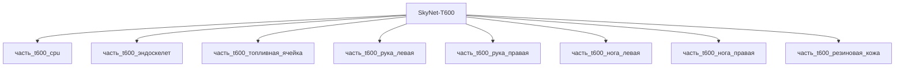

# Изделие-обёртка: SkyNet-T600

## Описание

Wrapper-изделие для модели `SkyNet-T600` (тип: гуманоидный, подсистема: каркас).

Создано для поддержки декомпозиции: дочерние части (часть_*) ссылаются на
этот id как на родителя. Сама модель остаётся в фантастические данные/модели/.

## Декомпозиция

## Состав

Дочерние части:
- `часть_t600_cpu`
- `часть_t600_эндоскелет`
- `часть_t600_топливная_ячейка`
- `часть_t600_рука_левая`
- `часть_t600_рука_правая`
- `часть_t600_нога_левая`
- `часть_t600_нога_правая`
- `часть_t600_резиновая_кожа`

## Связанная модель

- [`SkyNet-T600`](../../../фантастические%20данные/модели/) — модель SkyNet

## Источники

- Wrapper-изделие создано автоматически (2026-11-03) для поддержки декомпозиции
