# Изделие-обёртка: SkyNet-T800

## Описание

Wrapper-изделие для модели `SkyNet-T800` (тип: гуманоидный, подсистема: каркас).

Создано для поддержки декомпозиции: дочерние части (часть_*) ссылаются на
этот id как на родителя. Сама модель остаётся в фантастические данные/модели/.

## Декомпозиция

```mermaid
graph TD
    T800["SkyNet-T800"]
    t800_cpu["часть_t800_cpu"]
    T800 --> t800_cpu
    t800_топливная_ячейка_1["часть_t800_топливная_ячейка_1"]
    T800 --> t800_топливная_ячейка_1
    t800_топливная_ячейка_2["часть_t800_топливная_ячейка_2"]
    T800 --> t800_топливная_ячейка_2
    t800_эндоскелет_торс["часть_t800_эндоскелет_торс"]
    T800 --> t800_эндоскелет_торс
    t800_рука_левая["часть_t800_рука_левая"]
    T800 --> t800_рука_левая
    t800_рука_правая["часть_t800_рука_правая"]
    T800 --> t800_рука_правая
    t800_нога_левая["часть_t800_нога_левая"]
    T800 --> t800_нога_левая
    t800_нога_правая["часть_t800_нога_правая"]
    T800 --> t800_нога_правая
    t800_оптический_сенсор_1["часть_t800_оптический_сенсор_1"]
    T800 --> t800_оптический_сенсор_1
    t800_оптический_сенсор_2["часть_t800_оптический_сенсор_2"]
    T800 --> t800_оптический_сенсор_2
    t800_аудио_сенсор["часть_t800_аудио_сенсор"]
    T800 --> t800_аудио_сенсор
    t800_антенна["часть_t800_антенна"]
    T800 --> t800_антенна
    t800_гиро_навигация["часть_t800_гиро_навигация"]
    T800 --> t800_гиро_навигация
    t800_ткань_кожа["часть_t800_ткань_кожа"]
    T800 --> t800_ткань_кожа
```

## Состав

Дочерние части:
- `часть_t800_cpu`
- `часть_t800_топливная_ячейка_1`
- `часть_t800_топливная_ячейка_2`
- `часть_t800_эндоскелет_торс`
- `часть_t800_рука_левая`
- `часть_t800_рука_правая`
- `часть_t800_нога_левая`
- `часть_t800_нога_правая`
- `часть_t800_оптический_сенсор_1`
- `часть_t800_оптический_сенсор_2`
- `часть_t800_аудио_сенсор`
- `часть_t800_антенна`
- `часть_t800_гиро_навигация`
- `часть_t800_ткань_кожа`

## Связанная модель

- [`SkyNet-T800`](../../../фантастические%20данные/модели/) — модель SkyNet

## Источники

- Wrapper-изделие создано автоматически (2026-11-03) для поддержки декомпозиции
