# Изделие-обёртка: SkyNet-T850

## Описание

Wrapper-изделие для модели `SkyNet-T850` (тип: гуманоидный, подсистема: каркас).

Создано для поддержки декомпозиции: дочерние части (часть_*) ссылаются на
этот id как на родителя. Сама модель остаётся в фантастические данные/модели/.

## Декомпозиция

```mermaid
graph TD
    T850["SkyNet-T850"]
    t850_cpu["часть_t850_cpu"]
    T850 --> t850_cpu
    t850_топливная_ячейка_1["часть_t850_топливная_ячейка_1"]
    T850 --> t850_топливная_ячейка_1
    t850_топливная_ячейка_2["часть_t850_топливная_ячейка_2"]
    T850 --> t850_топливная_ячейка_2
    t850_эндоскелет["часть_t850_эндоскелет"]
    T850 --> t850_эндоскелет
    t850_рука_левая["часть_t850_рука_левая"]
    T850 --> t850_рука_левая
    t850_рука_правая["часть_t850_рука_правая"]
    T850 --> t850_рука_правая
    t850_нога_левая["часть_t850_нога_левая"]
    T850 --> t850_нога_левая
    t850_нога_правая["часть_t850_нога_правая"]
    T850 --> t850_нога_правая
    t850_сенсоры["часть_t850_сенсоры"]
    T850 --> t850_сенсоры
    t850_связь["часть_t850_связь"]
    T850 --> t850_связь
    t850_навигация["часть_t850_навигация"]
    T850 --> t850_навигация
    t850_ткань_кожа["часть_t850_ткань_кожа"]
    T850 --> t850_ткань_кожа
```

## Состав

Дочерние части:
- `часть_t850_cpu`
- `часть_t850_топливная_ячейка_1`
- `часть_t850_топливная_ячейка_2`
- `часть_t850_эндоскелет`
- `часть_t850_рука_левая`
- `часть_t850_рука_правая`
- `часть_t850_нога_левая`
- `часть_t850_нога_правая`
- `часть_t850_сенсоры`
- `часть_t850_связь`
- `часть_t850_навигация`
- `часть_t850_ткань_кожа`

## Связанная модель

- [`SkyNet-T850`](../../../фантастические%20данные/модели/) — модель SkyNet

## Источники

- Wrapper-изделие создано автоматически (2026-11-03) для поддержки декомпозиции
