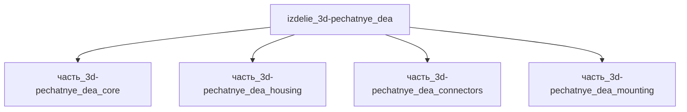

# Изделие: 3D-печатные DEA

## Описание

3D-печатные DEA

Полное наименование (как в CSV): `3D-печатные DEA`

## Технические характеристики

| Параметр | Значение | Единица | Источник |
|---|---|---|---|
| подсистема | приводная_система | — | classify_subsystem |
| категория | прочее | — | — |
| габариты (Д×Ш×В) | 150×90×85 | mm | bounding box лабораторной DEA-сборки: корпус 128×68×58 (acb677, SHV-консоль +41 мм), рама предрастяжения 120×60×25, HV-зазоры/standoff для 3–5 кВ (зазоры ~5–10 мм/кВ в воздухе); V=1.15 л ≥ Σ V(детей)×1.15=1.009 л |

(Параметры требуют уточнения через веб-поиск и вычислений; см. fc_изделие_масса, fc_изделие_стандарты в _field_contracts.yaml)

## Состав

Изделие верхнего уровня. Дочерние части не указаны (требуется декомпозиция).

## Используемые технологии

(Ссылки на реальные_данные/технологии/ добавляются после связывания)

## Используемые материалы

(Ссылки на реальные_данные/материалы/ добавляются после связывания)

## Принцип работы

Требует описания на основе инженерного анализа.

## Источники

- CSV: `начальные данные_final.csv` (пользовательский ввод)

---

## Декомпозиция

