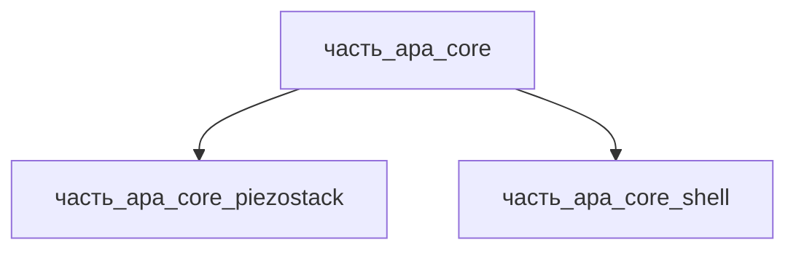

# Часть: часть_apa_core

## Описание

Усиленный пьезоэлектрический привод (Amplified Piezo Actuator, APA®) — ядро актуатора: низковольтный многослойный пьезостек (MLA), преднапряжённый и геометрически усиленный упругой лямбда-оболочкой. Референсное исполнение — Cedrat Technologies APA35XS: габариты 6×13×9 мм (по осям Д×Ш×В: 13×6×9), масса 1.3 г, номинальный ход 52 мкм, блокирующая сила 27 Н, жёсткость 0.52 Н/мкм, ёмкость 0.3 мкФ, резонанс 3880 Гц, питание −20…+150 В (CTEC паспорт; таблица спецификаций Micromechatronics). Материал — Ti-6Al-4V (упругая оболочка, 61.5 %) + сегнетокерамика BaTiO₃ (MLA, 38.5 %).

Декомпозиция (F34, 2026-11-08): ядро разделено на две атомарные части уровня 3 — `часть_apa_core_piezostack` (MLA-стек, 0.0005 кг = 38.5 %, первичный ход ~11 мкм, диэлектрические потери 0.85 Вт) и `часть_apa_core_shell` (лямбда-оболочка-усилитель, 0.0008 кг = 61.5 %, усиление ~4.7×, преднапряжение, гистерезис шарниров 0.15 Вт). Оболочка монолитно охватывает стек (сборка неразъёмна — разборка разрушает преднапряжение), но части различаются по материалу, физике работы и вкладу в тепловыделение, что отражает BOM.

Родитель: `izdelie_apa` (подсистема: приводная_система).

## Технические характеристики

| Параметр | Значение | Единица | Источник |
|---|---|---|---|
| подсистема | приводная_система | — | canon |
| подтип | основной_элемент | — | canon |
| масса | 0.0013 | kg | APA35XS: 1.3 г (каталог CTEC, ряд XS) |
| доля массы родителя | 0.0013 | — | расчёт (0.0013 / 1 кг номинал `izdelie_apa`) |
| габариты (Д×Ш×В) | 13×6×9 | mm | APA35XS 6×13×9 мм (Micromechatronics, таблица APA) |
| выработка энергии | 0 | W | canon |
| выработка тепла | 1 | W | canon (динамический режим; Σ детей = 0.85 MLA + 0.15 оболочка) |
| материал | batio3 (MLA 0.385) + ti-6al-4v (оболочка 0.615) | — | перовскитная сегнетокерамика P4mm + Ti-6Al-4V (немагнитная опция CTEC) |
| номинальный ход | 52 | μm | APA35XS паспорт (CTEC) |
| блокирующая сила | 27 | N | APA35XS паспорт (CTEC) |
| жёсткость | 0.52 | N/μm | APA35XS паспорт (CTEC) |
| ёмкость | 0.3 | μF | APA35XS паспорт (CTEC) |
| резонансная частота | 3880 | Hz | APA35XS паспорт (CTEC, blocked-free) |
| рабочее напряжение | −20…+150 | V | Claeyssen/CTEC (APA35XS) |
| ресурс | до 10¹⁰ | циклов | Claeyssen/CTEC (непрерывное распределение напряжений в оболочке) |

## Принцип работы

Ядро APA преобразует напряжение −20…+150 В в усиленное перемещение. MLA-стек (обратный пьезоэлектрический эффект в тетрагональной P4mm-фазе) расширяется по толщине на ~0.1–0.15 % → первичный ход ~11 мкм; керамика работает только на сжатие. Лямбда-оболочка (Ti-6Al-4V, лист ~0.4 мм, гибкие шарниры) поворачивается вокруг шарниров, усиливая ход в ~4.7 раза до 52 мкм на выходном наконечнике; та же геометрия при сборке создаёт статическое сжатие MLA (преднапряжение). Блокирующая сила 27 Н, жёсткость 0.52 Н/мкм задаются жёсткостью шарниров. Изгиб оболочки даёт непрерывное распределение напряжений — ресурс до 10¹⁰ циклов. Тепловыделение ядра 1 Вт (динамический режим): 0.85 Вт — диэлектрический гистерезис керамики (tanδ ~2 %, потери C·V²·f·tanδ, отвод через электроды и контакт с оболочкой) + 0.15 Вт — гистерезис упругих шарниров и микро-трение в точке преднагрузки.

## Декомпозиция

## Состав

Промежуточная часть (уровень 2). Дочерние части (уровень 3):

- `часть_apa_core_piezostack` — MLA-стек (2 слоя керамики в параллель) 10×5×2.4 мм, 0.0005 кг, форма тетрагональная_P4mm (неделимый)
- `часть_apa_core_shell` — лямбда-оболочка-усилитель 12×5×7.5 мм, 0.0008 кг, форма планер_и_космические_изделия (неделимый)

## Используемые материалы

- `batio3` → [`batio3.md`](../../../../материалы/batio3.md) — сегнетокерамика MLA (через `часть_apa_core_piezostack`); форма: `тетрагональная_P4mm` — «пьезоактюаторы и датчики», d₃₃ 78 пКл/Н
- `ti-6al-4v` → [`ti-6al-4v.md`](../../../../материалы/ti-6al-4v.md) — упругая оболочка (через `часть_apa_core_shell`); форма: `планер_и_космические_изделия` — усталостная прочность 500–600 МПа при 10⁷ циклов

## Источники

- CTEC APA35XS — паспорт: ход 52 мкм, блокирующая сила 27 Н, жёсткость 0.52 Н/мкм, ёмкость 0.3 мкФ, резонанс 3880 Гц, опции «Strain gauge, Non-magnetic shell, Vacuum» — https://cedrat-technologies.com/produit/apa35xs (обращение 2026-11-08)
- Micromechatronics (MMech) — таблица спецификаций APA: APA35XS 6×13×9 мм, ход 52 мкм, 27 Н — https://www.mmech.com/cedrat-actuators/apa-overview/apas-specifications (обращение 2026-11-08)
- Claeyssen F. et al. (CTEC), «Amplified Piezoelectric Actuators: Static & Dynamic Applications» — оболочка преднапрягает керамику и усиливает ход, ресурс до 10¹⁰ циклов — https://www.researchgate.net/publication/228353527_Amplified_Piezoelectric_Actuators_Static_Dynamic_Applicatio (обращение 2026-11-08)
- Каталог CTEC «Mechatronic Solutions» — масса APA35XS 1.3 г (ряд XS: APA30uXS 0.15 г / APA35XS 1.3 г); конструкция APA®: низковольтная MLA + оболочка — https://cedrat-technologies.com/wp-content/uploads/downloads/mechatronic-solutions-catalogue.pdf (обращение 2026-11-08)
- Материалы: реальные данные/материалы/
