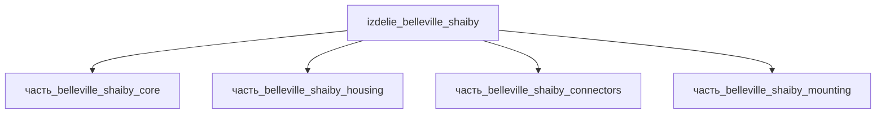

## Описание

Belleville шайбы

Полное наименование (как в CSV): `Belleville шайбы`

## Технические характеристики

| Параметр | Значение | Единица | Источник |
|---|---|---|---|
| подсистема | приводная_система | — | canon |
| подтип | прочее | — | canon |
| масса | 0.05–50 (номинал 1) | kg | canon |
| габариты (Д×Ш×В) | 100×50×50 | mm | canon |
| выработка энергии | 0 | W | canon |
| выработка тепла | 0.1–50 | W | canon |
| тип узла | изделие | — | canon |
| уровень_номер | 1 | — | canon |

## Принцип работы

Требует описания на основе инженерного анализа.

## Состав

Изделие верхнего уровня. Дочерние части не указаны (требуется декомпозиция).

## Используемые технологии

- `shtampovka_listovaya` (доля: 1.0)
- `frezervanie_chpu` (доля: 1.0)
- `lite_pod_davleniem` (доля: 1.0)
- `tokarnaya_obrabotka_chpu` (доля: 1.0)

## Используемые материалы

- `stal_st3` (форма: строительные_конструкции_и_крепёж) → [`stal_st3`](../../../материалы/stal_st3.md)
- `al_6061-t6` (форма: силовые_элементы_конструкций) → [`al_6061-t6`](../../../материалы/al_6061-t6.md)

## Источники

- CSV: `начальные данные_final.csv` (пользовательский ввод)

---

## Декомпозиция

