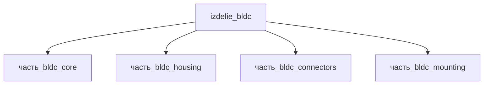

# Изделие: BLDC

## Описание

BLDC, 15 кВт — бесколлекторный двигатель постоянного тока в сборе с корпусом, разъёмным узлом и монтажным кронштейном. Референсное исполнение ядра — бесколлекторный двигатель класса Maxon EC45 (Ø45 мм, EC 45 flat 50 Вт; datasheet maxon 19-EN-266). Габаритный конверт изделия 120×60×109 мм — вертикальное исполнение сборки (IEC 60034-7, IM V1 — foot-mounted, вал вверх): основание L-кронштейна 120×60×5 мм (часть_bldc_mounting), над ним корпус Ø52×104 мм (часть_bldc_housing: ядро Ø45×90 с припуском ~15 % на стенки/крепёж), разъёмный узел 19.8×19.8×32 мм (часть_bldc_connectors) размещается вдоль оси внутри длины 120 мм. Проверка упаковки: V(конверт)=120×60×109=784 800 мм³ ≥ Σ V(детей)=512 011 мм³ × 1.15 = 588 813 мм³ (коэффициент запаса 1.33); по осям 120≥120, 60≥60, 109≥104. Масса номинал 1 кг (сумма детей 0.77 кг — ядро 0.35 + корпус 0.315 + разъёмы 0.055 + кронштейн 0.05).

Полное наименование (как в CSV): `BLDC, 15 кВт`

## Технические характеристики

| Параметр | Значение | Единица | Источник |
|---|---|---|---|
| подсистема | приводная_система | — | classify_subsystem |
| категория | машиностроение | — | canon |
| габариты (конверт сборки) | 120×60×109 | мм | maxon EC 45 flat datasheet 19-EN-266 (ядро Ø45) + кронштейн/корпус детей, IEC 60034-7 IM V1 |
| мощность (семейство) | до 15 | кВт | CSV `начальные данные_final.csv`; диапазон IEC frame 80–160 (NIDEC US Motors IEC Motor Specification) |

## Состав

Изделие верхнего уровня (уровень 1, подсистема приводная_система). Дочерние части уровня 2: часть_bldc_core (ядро Ø45×90, основной_элемент), часть_bldc_housing (корпус 52×52×104), часть_bldc_connectors (разъёмы MIL-DTL-38999, 19.8×19.8×32), часть_bldc_mounting (L-кронштейн 120×60×5, IEC 60034-7 IM B3/B5).

## Используемые технологии

(Ссылки на реальные_данные/технологии/ добавляются после связывания)

## Используемые материалы

(Ссылки на реальные_данные/материалы/ добавляются после связывания)

## Принцип работы

Требует описания на основе инженерного анализа.

## Источники

- CSV: `начальные данные_final.csv` (пользовательский ввод)

---

## Декомпозиция

