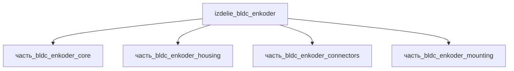

# Изделие: BLDC + энкодер

## Описание

BLDC + энкодер — безщёточный двигатель постоянного тока с интегральным энкодером (servo-модуль): статорный пакет в стальном корпусе Ø45–52 мм с инкрементальным/абсолютным энкодером на заднем фланце и милитари-разъёмом M38999. Envelope 70×70×160 мм (фланцевое основание + корпус двигателя 127 мм + разъёмная группа), масса ~1 кг.

Полное наименование (как в CSV): `BLDC + энкодер`

## Технические характеристики

| Параметр | Значение | Единица | Источник |
|---|---|---|---|
| подсистема | приводная_система | — | classify_subsystem |
| категория | прочее | — | — |
| масса (номинал) | 1.0 | kg | Σ детей 0.918 кг (core 0.42 + housing 0.378 + connectors 0.06 + mounting 0.06) + кабельная обвязка; maxon EC-i 40 50 W = 170 г, EC-i 52 класс ~0.7–1 кг |
| габариты (Д×Ш×В) | 70×70×160 | mm | корпус двигателя housing 52×52×127 (maxon EC-класс) + фланцевое основание mounting 45×42×40 + разъём |
| выработка тепла (номинал) | 5 | W | потери в меди/железе при номинальном режиме; maxon EC-i серия 30–800 Вт механических, КПД ~85–90 % |
| выработка тепла (диапазон) | 0.2–30 | W | от холостого хода до пикового момента |

Envelope родителя синхронизирован с дочерними частями: корпус двигателя housing 52×52×127 мм (maxongroup), статорный пакет core 45×45×110 мм, фланец mounting 45×42×40 мм (Aspina/Shimpo), разъём connectors 21.8×21.8×32 мм (M38999, NEPP NASA). Квадратный фланец 70×70 мм соответствует NEMA-классу под Ø52 корпус.

## Состав

Изделие верхнего уровня, 4 дочерние части: [`часть_bldc_enkoder_core`](часть_bldc_enkoder_core/_index.md) — статорный пакет с ротором, [`часть_bldc_enkoder_housing`](часть_bldc_enkoder_housing/_index.md) — корпус 52×52×127, [`часть_bldc_enkoder_mounting`](часть_bldc_enkoder_mounting/_index.md) — фланец/кронштейн, [`часть_bldc_enkoder_connectors`](часть_bldc_enkoder_connectors/_index.md) — разъёмы M38999.

## Используемые технологии

(Ссылки на реальные_данные/технологии/ добавляются после связывания)

## Используемые материалы

(Ссылки на реальные_данные/материалы/ добавляются после связывания)

## Принцип работы

Требует описания на основе инженерного анализа.

## Источники

- CSV: `начальные данные_final.csv` (пользовательский ввод)

---

## Декомпозиция

