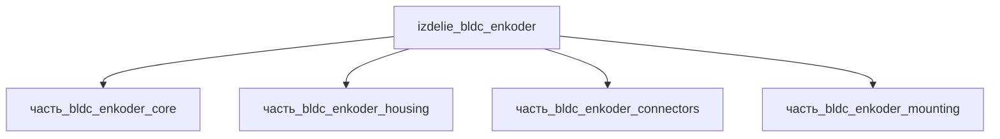

## Описание

BLDC + энкодер — безщёточный двигатель постоянного тока с интегральным энкодером (servo-модуль): статорный пакет в стальном корпусе Ø45–52 мм с инкрементальным/абсолютным энкодером на заднем фланце и милитари-разъёмом M38999. Envelope 70×70×160 мм (фланцевое основание + корпус двигателя 127 мм + разъёмная группа), масса ~1 кг.

Полное наименование (как в CSV): `BLDC + энкодер`

## Технические характеристики

| Параметр | Значение | Единица | Источник |
|---|---|---|---|
| подсистема | приводная_система | — | canon |
| подтип | прочее | — | canon |
| масса | 0.6–2.0 (номинал 1) | kg | canon |
| габариты (Д×Ш×В) | 70×70×160 | mm | canon |
| выработка энергии | 0 | W | canon |
| выработка тепла | 0.2–30 | W | canon |
| тип узла | изделие | — | canon |
| уровень_номер | 1 | — | canon |

## Принцип работы

Требует описания на основе инженерного анализа.

## Состав

Изделие верхнего уровня, 4 дочерние части: [`часть_bldc_enkoder_core`](часть_bldc_enkoder_core/_index.md) — статорный пакет с ротором, [`часть_bldc_enkoder_housing`](часть_bldc_enkoder_housing/_index.md) — корпус 52×52×127, [`часть_bldc_enkoder_mounting`](часть_bldc_enkoder_mounting/_index.md) — фланец/кронштейн, [`часть_bldc_enkoder_connectors`](часть_bldc_enkoder_connectors/_index.md) — разъёмы M38999.

## Используемые технологии

- `frezervanie_chpu` (доля: 1.0)
- `frezervanie_chpu` (доля: 1.0)
- `tokarnaya_obrabotka_chpu` (доля: 1.0)
- `frezervanie_chpu` (доля: 1.0)

## Используемые материалы

- `al_6061-t6` (форма: силовые_элементы_конструкций) → [`al_6061-t6`](../../../материалы/al_6061-t6.md)
- `al_6061-t6` (форма: силовые_элементы_конструкций) → [`al_6061-t6`](../../../материалы/al_6061-t6.md)

## Источники

- CSV: `начальные данные_final.csv` (пользовательский ввод)

---

## Декомпозиция

