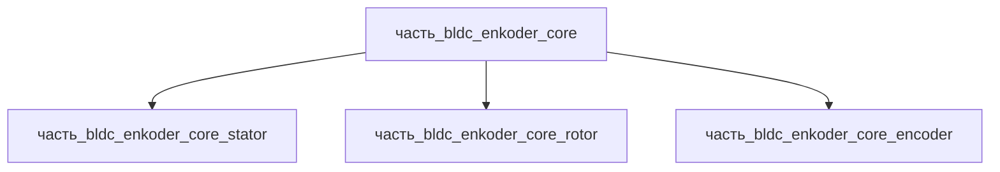

# Часть: часть_bldc_enkoder_core

## Описание

BLDC-двигатель с встроенным инкрементальным энкодером (500–4096 imp/rev) — сервоприводная ось с обратной связью по положению. Референсное исполнение — BLDC Ø45 с энкодером (длина 110 мм с установкой инкрементального энкодера). Габариты 45×45×110 мм, масса 0.42 кг — паспортные данные (BLDC Ø45 с энкодером). Материал — al_6061-t6: конструкционный алюминиевый сплав 6061-T6.

Родитель: `izdelie_bldc_enkoder` (подсистема: приводная_система).

## Технические характеристики

| Параметр | Значение | Единица | Источник |
|---|---|---|---|
| подсистема | приводная_система | — | canon |
| подтип | основной_элемент | — | canon |
| масса | 0.42 | kg | BLDC Ø45 с энкодером (длина 110 мм с установкой инкрементального энкодера) |
| доля массы родителя | 0.5 | — | canon |
| габариты (Д×Ш×В) | 45×45×110 | mm | BLDC Ø45 с энкодером (длина 110 мм с установкой инкрементального энкодера) |
| выработка энергии | 0 | W | canon |
| выработка тепла | 1 | W | canon |
| материал | al_6061-t6 | — | BLDC Ø45 с энкодером (длина 110 мм с установкой инкрементального энкодера) | canon |

## Принцип работы

Серво-ось «BLDC + энкодер»: трёхфазная обмотка статора создаёт вращающееся поле, втягивающее внешний NdFeB-ротор в синхронное вращение (коммутация по Hall-датчикам, номинал 50 Вт, КПД 85–90 %); на заднем конце вала магнитный полюсный диск вращается над MR-сенсором энкодера, формируя квадратуру A/B (500–4096 imp/rev) и индекс Z — обратная связь по положению замыкается в сервоконтроллере. Тепловыделение оси распределено: статор ~0.75 Вт (I²R + железо), ротор ~0.05 Вт (вихревые токи), энкодер ~0.1 Вт (ASIC).

## Состав

Составная часть (уровень 2): BLDC-двигатель с энкодером — статор, внешний ротор, инкрементальный энкодер.

## Используемые материалы

- `al_6061-t6` → [`al_6061-t6.md`](../../../../материалы/al_6061-t6.md) — конструкционный алюминиевый сплав 6061-T6

## Источники

- BLDC Ø45 с энкодером (длина 110 мм с установкой инкрементального энкодера) — https://www.maxongroup.com (обращение 2026-11-05)
- Канон: декомпозиция `izdelie_bldc_enkoder` (web search 2026-11-03)
- Материалы: реальные данные/материалы/
