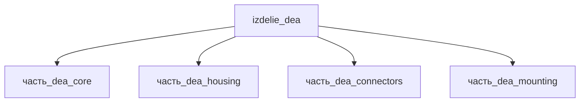

## Описание

DEA — диэлектрический эластомерный актуатор (Dielectric Elastomer Actuator): предрастянутая диэлектрическая мембрана (VHB/ELASTOSIL Film 2030) с complying-электродами, зажатая в жёсткой рамке 80×80 мм; при 2,5–5 кВ мембрана сжимается по Максвеллову давлению, создавая перемещение активной зоны. Envelope устройства 85×85×45 мм, масса ~80 г.

Полное наименование (как в CSV): `DEA`

## Технические характеристики

| Параметр | Значение | Единица | Источник |
|---|---|---|---|
| подсистема | приводная_система | — | canon |
| подтип | прочее | — | canon |
| масса | 0.05–0.15 (номинал 0.08) | kg | canon |
| габариты (Д×Ш×В) | 93×93×51 | mm | canon |
| выработка энергии | 0 | W | canon |
| выработка тепла | 0.1–50 | W | canon |
| тип узла | изделие | — | canon |
| уровень_номер | 1 | — | canon |

## Принцип работы

Требует описания на основе инженерного анализа.

## Состав

Изделие верхнего уровня, 4 дочерние части: [`часть_dea_core`](часть_dea_core/_index.md) — мембрана с электродами, [`часть_dea_housing`](часть_dea_housing/_index.md) — корпус, [`часть_dea_connectors`](часть_dea_connectors/_index.md) — HV-разъёмы, [`часть_dea_mounting`](часть_dea_mounting/_index.md) — опорная рамка 80×80×8 мм.

## Используемые технологии

- `vyrubka_listovyh_elastomerov` (доля: 1.0)
- `frezervanie_chpu` (доля: 1.0)

## Используемые материалы

- `elastomernaya_matritsa` (форма: плёнка_DEA_core) → [`elastomernaya_matritsa`](../../../материалы/elastomernaya_matritsa.md)
- `al_6061-t6` (форма: корпуса_электроники) → [`al_6061-t6`](../../../материалы/al_6061-t6.md)

## Источники

- CSV: `начальные данные_final.csv` (пользовательский ввод)

---

## Декомпозиция

