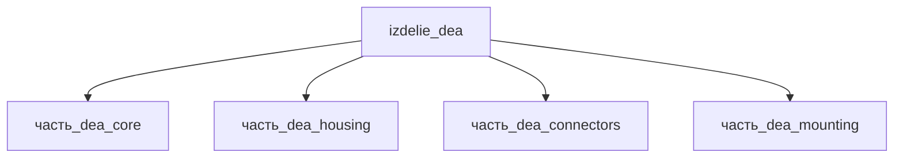

# Изделие: DEA

## Описание

DEA — диэлектрический эластомерный актуатор (Dielectric Elastomer Actuator): предрастянутая диэлектрическая мембрана (VHB/ELASTOSIL Film 2030) с complying-электродами, зажатая в жёсткой рамке 80×80 мм; при 2,5–5 кВ мембрана сжимается по Максвеллову давлению, создавая перемещение активной зоны. Envelope устройства 85×85×45 мм, масса ~80 г.

Полное наименование (как в CSV): `DEA`

## Технические характеристики

| Параметр | Значение | Единица | Источник |
|---|---|---|---|
| подсистема | приводная_система | — | classify_subsystem |
| категория | прочее | — | — |
| масса (номинал) | 0.08 | kg | Σ детей 0.07 кг (core 10 г + housing 15 г + connectors 20 г + mounting 25 г) + винты/Kapton-изоляция |
| габариты (Д×Ш×В) | 85×85×45 | mm | envelope планарного DEA: рамка 80×80 мм (PMC7770812) + HV-разъёмы 42 мм |
| выработка тепла (номинал) | 5 | W | ёмкостная нагрузка, саморазогрев плёнки |

Габаритный envelope родителя синхронизирован с дочерними частями: опорная рамка mounting 80×80×8 мм (Li, 2019, PMC7770812 — планарный DEA с жёсткой рамкой, ELASTOSIL Film 2030), мембрана core 60×60 мм, HV-разъёмы 14.3×14.3×42 мм — по высоте определяют 45 мм (42 мм + изоляционные клеммы). Для сравнения: крупные планарные DEA (Jordi et al., 2010, EMPA) используют мембраны порядка 100 мм в рамке; планарные VHB-актуаторы строятся на рамках с окном 50×50 мм и внешним размером ~80×80 мм (Lai, 2011, Iowa State).

## Состав

Изделие верхнего уровня, 4 дочерние части: [`часть_dea_core`](часть_dea_core/_index.md) — мембрана с электродами, [`часть_dea_housing`](часть_dea_housing/_index.md) — корпус, [`часть_dea_connectors`](часть_dea_connectors/_index.md) — HV-разъёмы, [`часть_dea_mounting`](часть_dea_mounting/_index.md) — опорная рамка 80×80×8 мм.

## Используемые технологии

(Ссылки на реальные_данные/технологии/ добавляются после связывания)

## Используемые материалы

(Ссылки на реальные_данные/материалы/ добавляются после связывания)

## Принцип работы

Требует описания на основе инженерного анализа.

## Источники

- CSV: `начальные данные_final.csv` (пользовательский ввод)

---

## Декомпозиция

