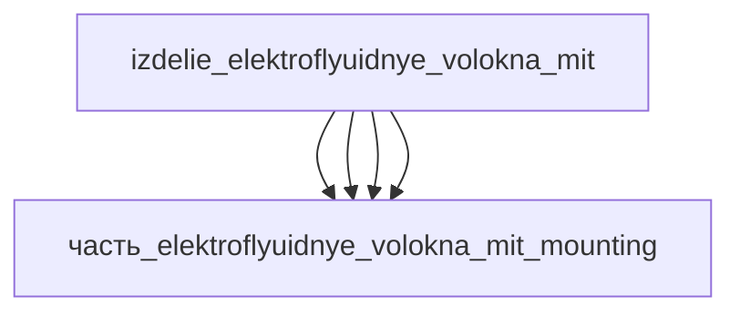

# Изделие: Электрофлюидные волокна MIT

## Описание

Электрофлюидные волокна MIT — модуль пучка электрофлюидных волоконных мышц (Electrofluidic Fiber Muscles, MIT / Science Robotics 2026, Afsar, Cacucciolo и др.): волокна миллиметрового масштаба (не толще зубочистки, несколько граммов каждое) с миниатюрными EHD-насосами твёрдотельного типа, закачивающими заряд в диэлектрическую жидкость в замкнутом контуре (без внешнего резервуара). Пучок конфигурации «strong» поднимает 4 кг; рычаг «fast» — выброс за 0.2 с; плетёная пара «бицепс-трицепс» сгибает роборукую. Габаритный конверт модуля 133×12×10 мм — осевая сборка: кожух пучка 115×8×8 (часть_elektroflyuidnye_volokna_mit_housing: волокно 100×5×5 с припуском ~15 %) + торцевой манифольд-блок 18×12×10 (часть_elektroflyuidnye_volokna_mit_mounting: 6× посадок Ø1.2 мм, флюидный порт ISO 6149 M3), продолжающий ось: 115+18=133 мм; ZIF-шлейф 18×5×2.6 (часть_elektroflyuidnye_volokna_mit_connectors) укладывается вдоль блока. Проверка упаковки: V(конверт)=133×12×10=15 960 мм³ ≥ Σ V(детей)=12 254 мм³ × 1.15 = 14 092 мм³ (коэффициент запаса 1.30); по осям 133≥115, 12≥12, 10≥10.

Полное наименование (как в CSV): `Электрофлюидные волокна MIT`

## Технические характеристики

| Параметр | Значение | Единица | Источник |
|---|---|---|---|
| подсистема | приводная_система | — | classify_subsystem |
| категория | машиностроение | — | canon |
| габариты (конверт модуля) | 133×12×10 | мм | осевая сборка: кожух 115×8×8 + манифольд 18×12×10 (дети); MIT News 2026-04-09, «Electrofluidic fiber muscles», Science Robotics |
| диаметр волокна | миллиметровый (не толще зубочистки) | — | MIT News 2026-04-09 |
| нагрузка пучка | 4 | кг | MIT News 2026-04-09 (strong bundle) |
| быстродействие (рычаг fast) | 0.2 | с | MIT News 2026-04-09 |

## Состав

Изделие верхнего уровня (уровень 1, подсистема приводная_система). Дочерние части уровня 2: часть_elektroflyuidnye_volokna_mit_core (волокно с EHD-насосом, 100×5×5), часть_elektroflyuidnye_volokna_mit_housing (кожух пучка 115×8×8), часть_elektroflyuidnye_volokna_mit_connectors (ZIF FPC 24-конт., 18×5×2.6), часть_elektroflyuidnye_volokna_mit_mounting (торцевой манифольд 18×12×10).

## Используемые технологии

(Ссылки на реальные_данные/технологии/ добавляются после связывания)

## Используемые материалы

(Ссылки на реальные_данные/материалы/ добавляются после связывания)

## Принцип работы

Требует описания на основе инженерного анализа.

## Источники

- CSV: `начальные данные_final.csv` (пользовательский ввод)

---

## Декомпозиция

