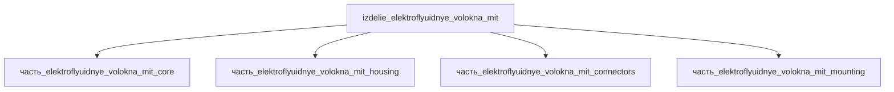

## Описание

Электрофлюидные волокна MIT — модуль пучка электрофлюидных волоконных мышц (Electrofluidic Fiber Muscles, MIT / Science Robotics 2026, Afsar, Cacucciolo и др.): волокна миллиметрового масштаба (не толще зубочистки, несколько граммов каждое) с миниатюрными EHD-насосами твёрдотельного типа, закачивающими заряд в диэлектрическую жидкость в замкнутом контуре (без внешнего резервуара). Пучок конфигурации «strong» поднимает 4 кг; рычаг «fast» — выброс за 0.2 с; плетёная пара «бицепс-трицепс» сгибает роборукую. Габаритный конверт модуля 133×12×10 мм — осевая сборка: кожух пучка 115×8×8 (часть_elektroflyuidnye_volokna_mit_housing: волокно 100×5×5 с припуском ~15 %) + торцевой манифольд-блок 18×12×10 (часть_elektroflyuidnye_volokna_mit_mounting: 6× посадок Ø1.2 мм, флюидный порт ISO 6149 M3), продолжающий ось: 115+18=133 мм; ZIF-шлейф 18×5×2.6 (часть_elektroflyuidnye_volokna_mit_connectors) укладывается вдоль блока. Проверка упаковки: V(конверт)=133×12×10=15 960 мм³ ≥ Σ V(детей)=12 254 мм³ × 1.15 = 14 092 мм³ (коэффициент запаса 1.30); по осям 133≥115, 12≥12, 10≥10.

Полное наименование (как в CSV): `Электрофлюидные волокна MIT`

## Технические характеристики

| Параметр | Значение | Единица | Источник |
|---|---|---|---|
| подсистема | приводная_система | — | canon |
| подтип | прочее | — | canon |
| масса | 0.05–50 (номинал 1) | kg | canon |
| габариты (Д×Ш×В) | 133×12×10 | mm | canon |
| выработка энергии | 0 | W | canon |
| выработка тепла | 0.1–50 | W | canon |
| тип узла | изделие | — | canon |
| уровень_номер | 1 | — | canon |

## Принцип работы

Требует описания на основе инженерного анализа.

## Состав

Изделие верхнего уровня (уровень 1, подсистема приводная_система). Дочерние части уровня 2: часть_elektroflyuidnye_volokna_mit_core (волокно с EHD-насосом, 100×5×5), часть_elektroflyuidnye_volokna_mit_housing (кожух пучка 115×8×8), часть_elektroflyuidnye_volokna_mit_connectors (ZIF FPC 24-конт., 18×5×2.6), часть_elektroflyuidnye_volokna_mit_mounting (торцевой манифольд 18×12×10).

## Используемые технологии

- `mikrovolokna_electrospinning` (доля: 1.0)
- `anodirovanie` (доля: 1.0)

## Используемые материалы

- `ionnaya_zhidkost_emim_tfsi` (форма: электролит_батарей_и_суперконденсаторов) → [`ionnaya_zhidkost_emim_tfsi`](../../../материалы/ionnaya_zhidkost_emim_tfsi.md)
- `al_6061-t6` (форма: крепёж_и_монтажные_плиты) → [`al_6061-t6`](../../../материалы/al_6061-t6.md)

## Источники

- CSV: `начальные данные_final.csv` (пользовательский ввод)

---

## Декомпозиция

