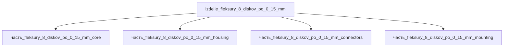

## Описание

флексуры 8 дисков по 0,15 мм (вместо 4×0,5), спираль 720°, отверстия разгрузки

Полное наименование (как в CSV): `флексуры 8 дисков по 0,15 мм (вместо 4×0,5), спираль 720°, отверстия разгрузки`

## Технические характеристики

| Параметр | Значение | Единица | Источник |
|---|---|---|---|
| подсистема | приводная_система | — | canon |
| подтип | прочее | — | canon |
| масса | 0.05–50 (номинал 1) | kg | canon |
| габариты (Д×Ш×В) | 100×60×50 | mm | canon |
| выработка энергии | 0 | W | canon |
| выработка тепла | 0.1–50 | W | canon |
| тип узла | изделие | — | canon |
| уровень_номер | 1 | — | canon |

## Принцип работы

Требует описания на основе инженерного анализа.

## Состав

Изделие верхнего уровня. Дочерние части не указаны (требуется декомпозиция).

## Используемые технологии

- `shtampovka_listovaya` (доля: 1.0)
- `frezervanie_chpu` (доля: 1.0)
- `tokarnaya_obrabotka_chpu` (доля: 1.0)
- `frezervanie_chpu` (доля: 1.0)

## Используемые материалы

- `becu` (форма: разъёмы_и_контакты) → [`becu`](../../../материалы/becu.md)
- `al_6061-t6` (форма: корпуса_электроники) → [`al_6061-t6`](../../../материалы/al_6061-t6.md)

## Источники

- CSV: `начальные данные_final.csv` (пользовательский ввод)
- Free-Flex® Pivot engineering data (flexpivots.com): AISI 410/420, серия 5000/6000, L/D ≈ 1.6 — продольная ось узла флексуры несёт длину корпуса/концевиков: https://flexpivots.com/products (проверено 2026-11-07)

---

## Декомпозиция

