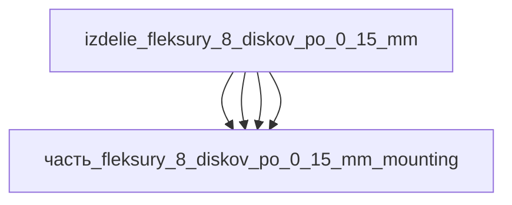

# Изделие: флексуры 8 дисков по 0,15 мм

## Описание

флексуры 8 дисков по 0,15 мм (вместо 4×0,5), спираль 720°, отверстия разгрузки

Полное наименование (как в CSV): `флексуры 8 дисков по 0,15 мм (вместо 4×0,5), спираль 720°, отверстия разгрузки`

## Технические характеристики

| Параметр | Значение | Единица | Источник |
|---|---|---|---|
| подсистема | приводная_система | — | classify_subsystem |
| категория | прочее | — | — |

(Параметры требуют уточнения через веб-поиск и вычислений; см. fc_изделие_масса, fc_изделие_стандарты в _field_contracts.yaml)

## Состав

Изделие верхнего уровня. Дочерние части не указаны (требуется декомпозиция).

## Используемые технологии

(Ссылки на реальные_данные/технологии/ добавляются после связывания)

## Используемые материалы

(Ссылки на реальные_данные/материалы/ добавляются после связывания)

## Принцип работы

Требует описания на основе инженерного анализа.

## Источники

- CSV: `начальные данные_final.csv` (пользовательский ввод)
- Free-Flex® Pivot engineering data (flexpivots.com): AISI 410/420, серия 5000/6000, L/D ≈ 1.6 — продольная ось узла флексуры несёт длину корпуса/концевиков: https://flexpivots.com/products (проверено 2026-11-07)

---

## Декомпозиция

