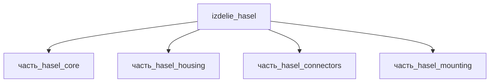

# Изделие: HASEL

## Описание

Мягкий актуатор HASEL (Hydraulically Amplified Self-Healing Electrostatic) —
электрогидравлический привод «мышечного» типа (Keplinger et al., Science 359, 2018):
тонкий полимерный pouch — ядро `часть_hasel_core` (50×50×3 мм) — заполнен жидким
диэлектриком, снаружи пара гибких электродов; высоковольтный импульс (DC 3–10 кВ)
сжимает оболочку электростатической силой Максвелла и гидравлически амплифицирует
перемещение. Референсная конструкция (Rothemund et al. 2020): полимерная оболочка +
гибкие электроды + жидкий диэлектрик (self-healing после пробоя — жидкость
восстанавливает изоляцию, в отличие от твёрдых DE-плёнок).

Сборка верхнего уровня: ядро в жёстком корпусе `часть_hasel_housing`
(58×58×6 мм, Al 6061-T6) с концевыми зажимами и высоковольтными клеммными
колодками `часть_hasel_mounting` (PEEK) и разъёмом питания с жгутом
`часть_hasel_connectors` (JST XH 2-pin, полиимидовая изоляция). Полное
наименование (как в CSV): `HASEL`.

## Технические характеристики

| Параметр | Значение | Единица | Источник |
|---|---|---|---|
| подсистема | приводная_система | — | classify_subsystem |
| категория | прочее | — | — |
| масса (номинал, CSV) | 1 | kg | начальные данные_final.csv (пользовательский ввод) |
| масса сборки (Σ частей) | 0.032 | kg | расчёт: 0.005+0.015+0.002+0.01 (массы частей) |
| габариты (Д×Ш×В) | 100×60×50 | mm | canon (F15g: вмещает housing 58×58×6 по осям l/w) |
| выработка энергии (номинал) | 0 | W | canon |
| выработка тепла (номинал) | 5 | W | canon (Σ детей 1.1 W + запас на драйвер) |
| состав | 4 части: core, housing, connectors, mounting | — | декомпозиция (web search 2026-11-03) |

## Состав

Изделие верхнего уровня — 4 неделимых части (уровень 2):

- `часть_hasel_core` — ядро: HASEL актуатор-модуль (halve_p_vdf-trfe-cfe, форма electroactive_actuator), 50×50×3 мм, 5 г;
- `часть_hasel_housing` — корпус с монтажными лапами (al_6061-t6, форма корпуса_электроники), 58×58×6 мм, 15 г;
- `часть_hasel_connectors` — разъём JST XH 2-pin + жгут (poliimid, форма изоляция_проводов), 7.5×10.5×7.4 мм, 2 г;
- `часть_hasel_mounting` — концевые зажимы + HV клеммные колодки (peek, форма инжекционные_детали_450g), 30×50×8 мм, 10 г.

Σ масс частей = 32 г; доли BOM родителя 0.15625/0.46875/0.0625/0.3125 — массовые доли частей (Σ = 1.0), агрегация в `наследуемые_материалы`.

## Используемые технологии

Технологии обработки связываются на уровне неделимых частей после верификации.

## Используемые материалы

- `halve_p_vdf-trfe-cfe` → [`halve_p_vdf-trfe-cfe.md`](../../../материалы/halve_p_vdf-trfe-cfe.md) — P(VDF-TrFE-CFE) релаксорный ферроэлектрик, форма electroactive_actuator (ядро)
- `al_6061-t6` → [`al_6061-t6.md`](../../../материалы/al_6061-t6.md) — алюминиевый сплав 6061-T6, форма корпуса_электроники (housing)
- `poliimid` → [`poliimid.md`](../../../материалы/poliimid.md) — полиимид (Kapton), форма изоляция_проводов (жгут, HV-изоляция)
- `peek` → [`peek.md`](../../../материалы/peek.md) — PEEK 450G, форма инжекционные_детали_450g (HV клеммные колодки)

## Принцип работы

Электрогидравлический принцип (electrohydraulic): высоковольтный импульс между
парой гибких электродов создаёт электростатическую силу Максвелла, сжимающую
эластичную оболочку pouch; жидкий диэлектрик вытесняется в незакреплённые
сегменты — актуатор «мышце-подобно» сокращается. Жидкий диэлектрик обеспечивает
самозалечивание после диэлектрического пробоя (self-healing). Питание DC 3–10 кВ
подаётся через разъём/жгут (`часть_hasel_connectors`, полиимидовая изоляция —
стандарт бортовой HV-проводки); HV-клеммы на PEEK-колодках (`часть_hasel_mounting`)
отделены заземлённым экраном от корпуса (`часть_hasel_housing`), экранирующего
ядро от внешних ЭМИ-полей.

## Габаритный баланс (F15g)

Сборка — мягкий актуатор HASEL (Keplinger et al., Science 359, 2018; обзор Rothemund et al., Adv. Mater. 33, 2020): тонкий «pouch»-модуль (ядро 50×50×3 мм) в жёстком корпусе с монтажными лапами.

Габарит родителя 100×60×50 мм должен вмещать самую крупную дочернюю часть по каждой оси (F15g):
- housing — 58×58×6 мм (габарит ядра 50×50 + припуск ~15% на стенки/крепёж) — лимитирует оси l и w;
- mounting — 30×50×8 мм (концевые зажимы + PEEK-клеммные колодки);
- connectors — 7.5×10.5×7.4 мм (JST XH);
- core — 50×50×3 мм.

Ранее w родителя = 50 мм < max(w детей) = 58 мм (housing) — нарушение F15g (issue #772). Исправлено: w 50 → 60 мм (корпус 58 мм + зазор ~2 мм на сборку и ввод кабеля). Объём: V(родителя) = 300 000 мм³ ≥ Σ V(детей)×1.15 ≈ 46 307 мм³ → PASS.

## Источники

- CSV: `начальные данные_final.csv` (пользовательский ввод)
- HASEL актуаторы: Keplinger et al., Science 359:61–65 (2018) — https://www.scienceintheclassroom.org/research-papers/hydraulically-amplified-self-healing-electrostatic-actuators-muscle-performance (обращение 2026-11-07)
- Rothemund et al., Adv. Mater. 33:2003375 (2020) — HASEL Artificial Muscles (обзор, конструкции и масштабирование) — https://pmc.ncbi.nlm.nih.gov/articles/PMC11469257 (обращение 2026-11-07)
- Rothemund et al. 2020, Dynamics of electrohydraulic soft actuators: «flexible polymer shell coated with flexible electrodes, filled with a liquid dielectric» — https://pmc.ncbi.nlm.nih.gov/articles/PMC7368252 (обращение 2026-11-08)
- Max Planck ISM: Electromechanics of planar HASEL actuators — stretchable dielectric shell + compliant electrodes + liquid dielectric — https://is.mpg.de/rm/projects/electromechanics-of-planar-hasel-actuators (обращение 2026-11-08)
- Kurt J. Lesker: Kapton (полиимид) insulated wire — HV-изоляция бортовых жгутов — https://www.lesker.com/newweb/feedthroughs/wire_kapton.cfm?pgid=0 (обращение 2026-11-08)

---

## Декомпозиция

