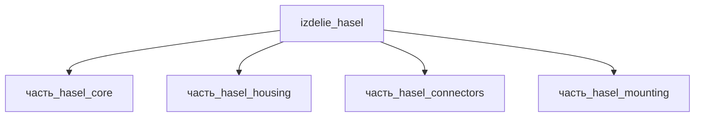

# Изделие: HASEL

## Описание

HASEL

Полное наименование (как в CSV): `HASEL`

## Технические характеристики

| Параметр | Значение | Единица | Источник |
|---|---|---|---|
| подсистема | приводная_система | — | classify_subsystem |
| категория | прочее | — | — |

(Параметры требуют уточнения через веб-поиск и вычислений; см. fc_изделие_масса, fc_изделие_стандарты в _field_contracts.yaml)

## Состав

Изделие верхнего уровня. Дочерние части не указаны (требуется декомпозиция).

## Используемые технологии

(Ссылки на реальные_данные/технологии/ добавляются после связывания)

## Используемые материалы

(Ссылки на реальные_данные/материалы/ добавляются после связывания)

## Принцип работы

Требует описания на основе инженерного анализа.

## Габаритный баланс (F15g)

Сборка — мягкий актуатор HASEL (Keplinger et al., Science 359, 2018; обзор Rothemund et al., Adv. Mater. 33, 2020): тонкий «pouch»-модуль (ядро 50×50×3 мм) в жёстком корпусе с монтажными лапами.

Габарит родителя 100×60×50 мм должен вмещать самую крупную дочернюю часть по каждой оси (F15g):
- housing — 58×58×6 мм (габарит ядра 50×50 + припуск ~15% на стенки/крепёж) — лимитирует оси l и w;
- mounting — 30×50×8 мм (концевые зажимы + PEEK-клеммные колодки);
- connectors — 7.5×10.5×7.4 мм (JST XH);
- core — 50×50×3 мм.

Ранее w родителя = 50 мм < max(w детей) = 58 мм (housing) — нарушение F15g (issue #772). Исправлено: w 50 → 60 мм (корпус 58 мм + зазор ~2 мм на сборку и ввод кабеля). Объём: V(родителя) = 300 000 мм³ ≥ Σ V(детей)×1.15 ≈ 46 307 мм³ → PASS.

## Источники

- CSV: `начальные данные_final.csv` (пользовательский ввод)
- HASEL актуаторы: Keplinger et al., Science 359:61–65 (2018) — https://www.scienceintheclassroom.org/research-papers/hydraulically-amplified-self-healing-electrostatic-actuators-muscle-performance (обращение 2026-11-07)
- Rothemund et al., Adv. Mater. 33:2003375 (2020) — HASEL Artificial Muscles (обзор, конструкции и масштабирование) — https://pmc.ncbi.nlm.nih.gov/articles/PMC11469257 (обращение 2026-11-07)

---

## Декомпозиция

