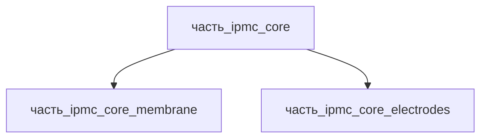

# Часть: часть_ipmc_core

## Описание

Ионный полимерно-металлический композит (IPMC) — сэндвич-структура из трёх функциональных слоёв: ионообменная мембрана Nafion N117 (183 мкм) между двумя платиновыми электродами (~15 мкм на сторону, electroless-осаждение). Референсное исполнение — IPMC-плёнка 30×10×0.3 мм, масса 0.001 кг (канон; реальный расчёт для 30×10 мм: Nafion 360 г/м² → 0.108 г + Pt 2–3 мг/см² × 6 см² → 12–18 мг).

Декомпозиция (F34, 2026-11-08): ядро разделено на две атомарные части уровня 3 — `часть_ipmc_core_membrane` (Nafion-мембрана, 85 % массы, ион-носители Li+/Na+) и `часть_ipmc_core_electrodes` (Pt-электроды обеих сторон, 15 % массы, джоулевы потери I²R). Слои химически сцеплены (металл растёт «изнутри наружу» при восстановлении Pt(NH₃)₄²⁺ борогидридом) — в полевых условиях не разделяются, но различаются по материалу, физике переноса и вкладу в тепловыделение, что отражает BOM.

Родитель: `izdelie_ipmc` (подсистема: приводная_система).

## Технические характеристики

| Параметр | Значение | Единица | Источник |
|---|---|---|---|
| подсистема | приводная_система | — | canon |
| подтип | основной_элемент | — | canon |
| масса | 0.001 | kg | IPMC-плёнка (30×10, ионный полимер + электроды) |
| доля массы родителя | 0.5 | — | canon |
| габариты (Д×Ш×В) | 30×10×0.3 | mm | IPMC-плёнка (30×10, ионный полимер + электроды) |
| выработка энергии | 0 | W | canon |
| выработка тепла | 1 | W | canon |
| материал | nafion (мембрана 0.85) + pt (электроды 0.15) | — | Nafion N117 183 мкм; Pt electroless ~15 мкм × 2 стороны |

## Принцип работы

Ядро IPMC преобразует низкое напряжение (1–5 В) в электромеханический изгиб. Платиновые электроды создают поперечное электрическое поле; фиксированные сульфоновые группы мембраны допускают миграцию только катионов (Li+/Na+) с сольватными оболочками — катионы дрейфуют к катоду, вызывая осмотическое набухание у катодной стороны и изгиб плёнки в сторону анода. Джоулевы потери в поверхностном сопротивлении электродов (~0.9 Вт из 1 Вт тепловыделения ядра) доминируют над ионными потерями мембраны (~0.1 Вт); тепло отводится через электроды в корпус актуатора. Электроды растут «изнутри наружу» (импрегнация Pt(NH₃)₄²⁺ + восстановление NaBH₄, метод Takenaka/Nemat-Nasser) — градиентный слой частиц 40–60 нм обеспечивает неразрывное сцепление при миллионах циклов изгиба.

## Декомпозиция

## Состав

Промежуточная часть (уровень 2). Дочерние части (уровень 3):

- `часть_ipmc_core_membrane` — Nafion N117 PFSA-мембрана 30×10×0.183 мм, 0.00085 кг, форма электросенсорика_и_актуаторы (неделимый)
- `часть_ipmc_core_electrodes` — Pt-электроды обеих сторон 30×10×0.03 мм, 0.00015 кг, форма катализаторы_и_катализаторные_покрытия (неделимый)

## Используемые материалы

- `nafion` → [`nafion.md`](../../../../материалы/nafion.md) — мембрана (через `часть_ipmc_core_membrane`); форма: `электросенсорика_и_актуаторы`
- `pt` → [`pt.md`](../../../../материалы/pt.md) — электродные слои (через `часть_ipmc_core_electrodes`); форма: `катализаторы_и_катализаторные_покрытия`
- технология сборки: `galvanika` — химическое осаждение Pt из раствора (материалы процесса: pt осаждаемый, nafion основа)

## Источники

- IPMC-плёнка (30×10, ионный полимер + электроды) — https://en.wikipedia.org/wiki/Ionic_polymer%E2%80%93metal_composite (обращение 2026-11-05)
- Tang G. et al., «A comprehensive survey of ionic polymer metal composite» (2023) — структура «ионный полимер + два электродных слоя», электроды ~15 мкм — https://www.sciencedirect.com/science/article/pii/S2211379721008548 (обращение 2026-11-08)
- He C. et al., «Preparation and Modification Technology Analysis of Ionic Polymer-Metal Composites» (2022) — electroless-осаждение Pt на Nafion — https://pmc.ncbi.nlm.nih.gov/articles/PMC8998928 (обращение 2026-11-08)
- Nafion (Chemours) — N117: толщина 183 мкм, базовая масса 360 г/м² — https://www.nafion.com/en/products/sulfonic-membranes (обращение 2026-11-08)
- Канон: декомпозиция `izdelie_ipmc` (web search 2026-11-03)
- Материалы: реальные данные/материалы/
