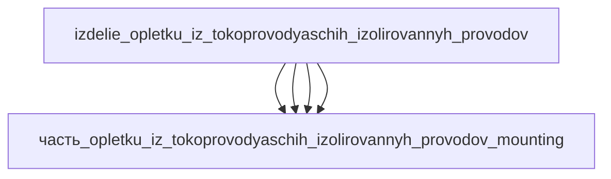

# Изделие: оплётку из токопроводящих изолированных проводов

## Описание

«Smart Braid» — упрочняющая оплётка пневматической мышцы Маккиббена, сплетённая из токопроводящих изолированных проводов, образующих соленоидоподобную цепь: при сокращении мышцы меняется геометрия оплётки и её индуктивность, что даёт встроенное измерение сокращения и силы без отдельных датчиков (Felt, Hunter, Remy — IEEE Trans. Robotics 2017). В канонической декомпозиции изделие представлено сборкой «жгут токопроводящих изолированных проводов в защитном кожухе»: ядро-жгут (силовые и сигнальные ветки, экранирующая оплётка, защитная обмотка) в жёстком кожухе с разъёмной панелью и монтажными кронштейнами. Габаритный конверт изделия 350×230×85 мм — сборка вокруг кожуха ядра 288×207×52 (часть_..._housing, припуск ~15 % к ядру 250×180×45): торцевая разъёмная панель с разъёмами 37.1×37.1×38 (часть_..._connectors) добавляет ~50 мм по длине (288+50=338≤350); монтажные кронштейны 45×18×18 (часть_..._mounting) по бокам — ширина 207+18+зазор=230; кабельные вводы и сервисная петля жгута сверху — высота 85. Проверка упаковки: V(конверт)=350×230×85=6 842 500 мм³ ≥ Σ V(детей)=5 191 916 мм³ × 1.15 = 5 970 703 мм³ (коэффициент 1.32); по осям 350≥288, 230≥207, 85≥52.

Полное наименование (как в CSV): `оплётку из токопроводящих изолированных проводов — «Smart Braid»`

## Технические характеристики

| Параметр | Значение | Единица | Источник |
|---|---|---|---|
| подсистема | приводная_система | — | classify_subsystem |
| категория | машиностроение | — | canon |
| габариты (конверт изделия) | 350×230×85 | мм | сборка: кожух ядра 288×207×52 + разъёмная панель ~50 мм + кронштейны и вводы (дети) |
| принцип «Smart Braid» | соленоидная оплётка из проводящих изолированных проводов, индуктивность ↦ сокращение/сила | — | Felt, Hunter, Remy, IEEE Trans. Robotics 2017 (PubMed 28503062) |
| измерение | встроенное (без датчиков): по изменению индуктивности | — | Felt et al. 2017 |

## Состав

Изделие верхнего уровня (уровень 1, подсистема приводная_система). Дочерние части уровня 2: часть_opletku_iz_tokoprovodyaschih_izolirovannyh_provodov_core (жгут 250×180×45, декомпозирован на 4 ветки уровня 3: силовые провода, сигнальные провода, экранирующая оплётка, защитная обмотка), часть_opletku_iz_tokoprovodyaschih_izolirovannyh_provodov_housing (кожух 288×207×52), часть_opletku_iz_tokoprovodyaschih_izolirovannyh_provodov_connectors (разъёмы 37.1×37.1×38), часть_opletku_iz_tokoprovodyaschih_izolirovannyh_provodov_mounting (кронштейны 45×18×18).

## Используемые технологии

(Ссылки на реальные_данные/технологии/ добавляются после связывания)

## Используемые материалы

(Ссылки на реальные_данные/материалы/ добавляются после связывания)

## Принцип работы

Как «Smart Braid» (Felt et al.): оплётка сплетена из токопроводящих изолированных проводов так, что пересекающиеся витки образуют соленоидоподобную цепь; сокращение мышцы меняет шаг и диаметр плетения, а с ними — индуктивность и взаимные ёмкости цепи, измеряемые снаружи: само усиление становится датчиком сокращения и силы. Как жгут в исполнении сборки: ядро распределяет питание (силовые ветки, омический нагрев ~0.6 Вт) и сигнальные цепи обратной связи, экранирующая оплётка защищает от ЭМИ, кожух с разъёмной панелью обеспечивает механическую защиту и подключение, кронштейны — монтаж в приводной системе.

## Источники

- Felt W., Hunter M., Remy C.D. Contraction Sensing with Smart Braid McKibben Muscles (IEEE Trans. Robotics 2017; оплётка McKibben-мышцы из токопроводящих изолированных проводов, соленоидная индуктивная сенсорика) — https://pubmed.ncbi.nlm.nih.gov/28503062/ (обращение 2026-11-08)
- Smart braid: Air muscles that measure force and contraction (Felt, Remy) — https://www.semanticscholar.org/paper/591606c18a4344dec7d9f1e773b75300f324f0ee (обращение 2026-11-08)
- CSV: `начальные данные_final.csv` (пользовательский ввод)

---

## Декомпозиция

