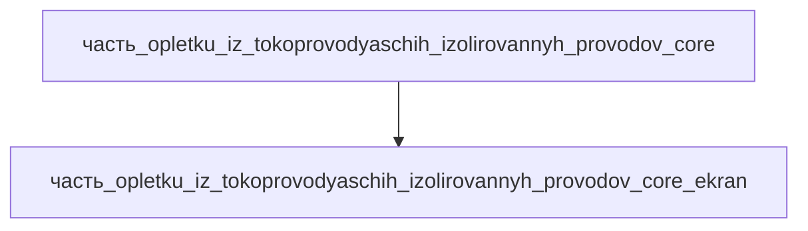

# Часть: часть_opletku_iz_tokoprovodyaschih_izolirovannyh_provodov_core_ekran

## Описание

Экранирующая оплётка жгута — трубчатая расширяемая оплётка из лужёной меди (tinned copper braid), EMI/RFI-экран поверх силовых и сигнальных веток жгута приводной системы. Референс — Glenair braided shielding: оплётка поставляется под все ходовые диаметры силовых и сигнальных кабелей, обеспечивает EMC-экранирование веток жгута. Габариты 250×35×8 мм (оплётка в развёртке, тонкостенная), масса 0.07 кг (16 % массы ядра жгута). Материал — copper: лужёная медная проволока оплётки (лужение — антикоррозионная защита и пайка).

Родитель: `часть_opletku_iz_tokoprovodyaschih_izolirovannyh_provodov_core` (подсистема: приводная_система).

## Технические характеристики

| Параметр | Значение | Единица | Источник |
|---|---|---|---|
| подсистема | приводная_система | — | canon |
| подтип | экранирование | — | canon |
| масса | 0.07 | kg | Glenair braided shielding |
| доля массы родителя | 0.16 | — | canon |
| габариты (Д×Ш×В) | 250×35×8 | mm | оплётка в развёртке жгута |
| выработка энергии | 0 | W | canon |
| выработка тепла | 0.2 | W | токи утечки/вихревые токи экрана |
| материал | copper | — | лужёная медь оплётки (tinned copper) |

## Принцип работы

Электростатическое и ЭМИ-экранирование веток жгута: оплётка заземляется на корпус, замыкая наводки от силовых линий (ШИМ-помехи приводов) до того, как они наведутся на сигнальные пары. Часть энергии экрана рассеивается теплом (~0.2 Вт).

## Состав

Атомарная часть (уровень 3, неделимый). Закупочная оплётка — в полевых условиях не разбирается.

## Используемые материалы

- `copper` → [`copper.md`](../../../../материалы/copper.md) — медь (лужёная оплётка)

## Источники

- Glenair — EMI/RFI Braided Cable Shielding / Tubular Expandable — https://www.glenair.com/braided-shielding-and-sleeving (обращение 2026-11-07)
- Канон: декомпозиция `часть_opletku_iz_tokoprovodyaschih_izolirovannyh_provodov_core` (F34, 2026-11-07)
- Материалы: реальные данные/материалы/

## Декомпозиция

