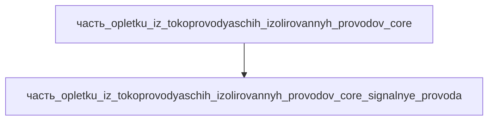

# Часть: часть_opletku_iz_tokoprovodyaschih_izolirovannyh_provodov_core_signalnye_provoda

## Описание

Сигнальные ветки жгута — тонкие медные провода 0.14–0.5 мм² (28–20 AWG), витые пары для энкодеров, датчиков положения и управляющих цепей сервоприводов приводной системы. Референс — servo/encoder cables (igus): цепи обратной связи приводов, малое сечение, витая пара для помехоустойчивости. Габариты 250×30×15 мм (связка сигнальных пар в развёртке жгута), масса 0.09 кг (20 % массы ядра жгута). Материал — copper: медные жилы Cu-ETP, тонкая многопроволочная скрутка (класс 5 по IEC 60228).

Родитель: `часть_opletku_iz_tokoprovodyaschih_izolirovannyh_provodov_core` (подсистема: приводная_система).

## Технические характеристики

| Параметр | Значение | Единица | Источник |
|---|---|---|---|
| подсистема | приводная_система | — | canon |
| подтип | сигнальные_цепи | — | canon |
| масса | 0.09 | kg | servo/encoder cables (igus) |
| доля массы родителя | 0.2 | — | canon |
| габариты (Д×Ш×В) | 250×30×15 | mm | развёртка сигнальных веток жгута |
| выработка энергии | 0 | W | canon |
| выработка тепла | 0.1 | W | омические потери малоточных цепей |
| материал | copper | — | медные жилы Cu-ETP (IEC 60228, класс 5) |

## Принцип работы

Передача маломощных сигналов обратной связи (энкодеры, датчики, управляющие линии) между контроллером и приводами. Витые пары тонких медных жил снижают наводки; токи малы, тепловыделение незначительное (~0.1 Вт).

## Состав

Атомарная часть (уровень 3, неделимый). Закупочный кабель — в полевых условиях не разбирается.

## Используемые материалы

- `copper` → [`copper.md`](../../../../материалы/copper.md) — медь (проводниковая, Cu-ETP)

## Источники

- Servo Motor Cables / Encoder Cables (igus) — https://www.igus.com/cables/servo-power-cables (обращение 2026-11-07)
- Канон: декомпозиция `часть_opletku_iz_tokoprovodyaschih_izolirovannyh_provodov_core` (F34, 2026-11-07)
- Материалы: реальные данные/материалы/

## Декомпозиция

