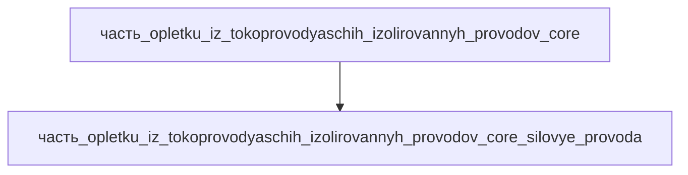

# Часть: часть_opletku_iz_tokoprovodyaschih_izolirovannyh_provodov_core_silovye_provoda

## Описание

Силовые ветки жгута — многопроволочные медные провода 2.5–6 мм² (10 AWG) с высокотемпературной силиконовой изоляцией (класс 180 °C), питание сервоприводов и мотор-редукторов приводной системы. Референс — chainflex servo power cables (igus): гибкие силовые кабели для динамической прокладки в приводах. Габариты 250×40×20 мм (связка силовых веток в развёртке жгута), масса 0.24 кг (53 % массы ядра жгута — силовые жилы самые тяжёлые). Материал — copper: медные жилы Cu-ETP, многопроволочная скрутка (класс 5 по IEC 60228).

Родитель: `часть_opletku_iz_tokoprovodyaschih_izolirovannyh_provodov_core` (подсистема: приводная_система).

## Технические характеристики

| Параметр | Значение | Единица | Источник |
|---|---|---|---|
| подсистема | приводная_система | — | canon |
| подтип | силовые_цепи | — | canon |
| масса | 0.24 | kg | chainflex servo power cables (igus) |
| доля массы родителя | 0.53 | — | canon |
| габариты (Д×Ш×В) | 250×40×20 | mm | развёртка силовых веток жгута |
| выработка энергии | 0 | W | canon |
| выработка тепла | 0.6 | W | омический нагрев I²R силовых линий |
| материал | copper | — | медные жилы Cu-ETP (IEC 60228, класс 5) |

## Принцип работы

Передача рабочего тока от силовой электроники к сервоприводам приводных осей. Многопроволочные медные жилы (класс 5, гибкие) в силиконовой изоляции 180 °C держат непрерывный рабочий ток приводов; омические потери I²R рассеиваются в виде тепла (~0.6 Вт на ветку жгута).

## Состав

Атомарная часть (уровень 3, неделимый). Закупочный кабель — в полевых условиях не разбирается.

## Используемые материалы

- `copper` → [`copper.md`](../../../../материалы/copper.md) — медь (проводниковая, Cu-ETP)

## Источники

- chainflex Servo Power Cables (igus) — https://www.igus.com/cables/servo-power-cables (обращение 2026-11-07)
- Канон: декомпозиция `часть_opletku_iz_tokoprovodyaschih_izolirovannyh_provodov_core` (F34, 2026-11-07)
- Материалы: реальные данные/материалы/

## Декомпозиция

