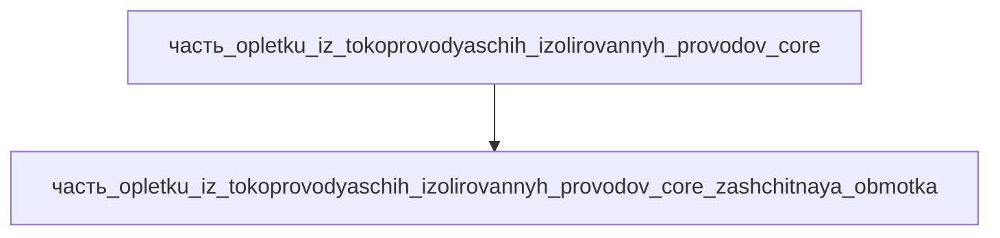

# Часть: часть_opletku_iz_tokoprovodyaschih_izolirovannyh_provodov_core_zashchitnaya_obmotka

## Описание

Защитная обмотка жгута — спирально навитая лента из фторопласт-плёночного ламината Tedlar/PET поверх всего пучка проводов, защита жгута приводной системы от истирания, перегибов и внешних воздействий. Референс — braided protection harness: защитные слои (оплётки, обмотки) поверх кабельного пучка; лента Tedlar/PET — классическая гибридная плёнка PVF/PET для наружной защиты. Габариты 250×75×10 мм (обмотка поверх полного пучка в развёртке), масса 0.05 кг (11 % массы ядра жгута). Материал — tedlar_pet, форма tpt_классическая_двусторонняя (двусторонний ламинат PVF/PET).

Родитель: `часть_opletku_iz_tokoprovodyaschih_izolirovannyh_provodov_core` (подсистема: приводная_система).

## Технические характеристики

| Параметр | Значение | Единица | Источник |
|---|---|---|---|
| подсистема | приводная_система | — | canon |
| подтип | изоляция | — | canon |
| масса | 0.05 | kg | braided protection harness (защитный слой пучка) |
| доля массы родителя | 0.11 | — | canon |
| габариты (Д×Ш×В) | 250×75×10 | mm | обмотка поверх полного пучка (развёртка) |
| выработка энергии | 0 | W | canon |
| выработка тепла | 0 | W | текстильная оплётка, ток не проводит |
| материал | tedlar_pet | — | лента TPT (PVF/PET ламинат) |

## Принцип работы

Механическая защита и организация пучка: спиральная обмотка лентой Tedlar/PET стягивает ветки жгута в единый пучок, защищает изоляцию от истирания о кромки рамы и направляющие; лента диэлектрик — ток не проводит, тепла не выделяет.

## Состав

Атомарная часть (уровень 3, неделимый). Лента и обмотка — в полевых условиях не разбирается.

## Используемые материалы

- `tedlar_pet` → [`pet.md`](../../../../материалы/pet.md) — Tedlar/PET (лента защитной обмотки)

## Источники

- Braided Protection Harness (защитные слои пучка) — https://supersmile-tech.com/products/braided-protection-harness (обращение 2026-11-07)
- Спиральная обмотка лентой — технология tekhnologia_spiralnaya_navivka
- Канон: декомпозиция `часть_opletku_iz_tokoprovodyaschih_izolirovannyh_provodov_core` (F34, 2026-11-07)
- Материалы: реальные данные/материалы/

## Декомпозиция

