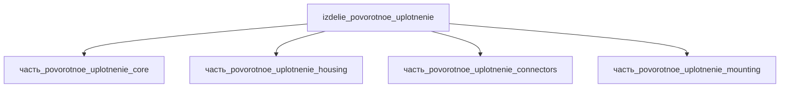

# Изделие: Поворотное уплотнение

## Описание

Поворотное уплотнение (rotary union)

Полное наименование (как в CSV): `Поворотное уплотнение (rotary union)`

## Технические характеристики

| Параметр | Значение | Единица | Источник |
|---|---|---|---|
| подсистема | приводная_система | — | classify_subsystem |
| категория | прочее | — | — |
| габариты (bounding box) | 120 × 107.95 × 107.95 | мм | Deublin 2620-000-252 |
| длина корпуса D | 120 | мм | Deublin 2620-000-252 |
| диаметр фланца A/I | 107.95 | мм | Deublin 2620-000-252 |
| каналы | 2 независимых | — | Deublin 2620-000-252 |
| среда | гидравлическое масло | — | Deublin 2620-000-252 |

Габариты bounding box приняты по реальному промышленному поворотному соединению Deublin
2620-000-252 (серия ST252, 2 канала, гидравлическое масло): длина корпуса D=120 мм,
диаметр фланца A=I=107.95 мм. Проверено 2026-11-08.
Источник: https://www.deublin.com/en/products/2620-000-252

## Состав

Изделие верхнего уровня (rotary union / поворотное соединение). Дочерние части:
- часть_povorotnoe_uplotnenie_core — уплотнительный узел (механическое торцевое уплотнение, балансированное)
- часть_povorotnoe_uplotnenie_housing — корпус с монтажным фланцем
- часть_povorotnoe_uplotnenie_connectors — резьбовые присоединения среды (1/4"-18 NPT класс)
- часть_povorotnoe_uplotnenie_mounting — фиксация корпуса против вращения

## Используемые технологии

(Ссылки на реальные_данные/технологии/ добавляются после связывания)

## Используемые материалы

(Ссылки на реальные_данные/материалы/ добавляются после связывания)

## Принцип работы

Поворотное соединение (rotary union) подаёт гидравлическую среду из неподвижной магистрали
во вращающийся узел через 2 независимых канала. Герметичность обеспечивается балансированным
механическим торцевым уплотнением (SiC/SiC, микролапка ≤2 световых полос): давление среды
уравновешивает силу прижима, снижая износ. Корпус (housing) фиксируется против вращения,
ротор с фланцем Ø107.95 мм монтируется на вал машины; присоединение среды — резьбовое
1/4"-18 NPT. Серия ST252 допускает самоустановку (self-aligning) с компенсацией перекоса.
Источник: Deublin ST252 steel-industry brochure; https://www.deublin.com/en/products/2620-000-252 (проверено 2026-11-08).

## Источники

- CSV: `начальные данные_final.csv` (пользовательский ввод)
- Deublin 2620-000-252 product page (серия ST252): https://www.deublin.com/en/products/2620-000-252 (проверено 2026-11-08)
- Deublin ST252 brochure: https://www.deublin.com/_Resources/Persistent/5/6/6/8/56683bfe9757615589678c9d6a347919abc3f6fd/SteelBrochure%20-%20ST252%20US_LowRes.pdf

---

## Декомпозиция

