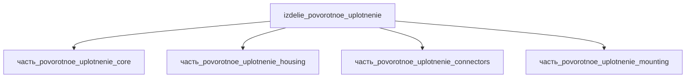

## Описание

Поворотное уплотнение (rotary union)

Полное наименование (как в CSV): `Поворотное уплотнение (rotary union)`

## Технические характеристики

| Параметр | Значение | Единица | Источник |
|---|---|---|---|
| подсистема | приводная_система | — | canon |
| подтип | прочее | — | canon |
| масса | 0.05–50 (номинал 1) | kg | canon |
| габариты (Д×Ш×В) | 120×107.95×107.95 | mm | canon |
| выработка энергии | 0 | W | canon |
| выработка тепла | 0.1–50 | W | canon |
| тип узла | изделие | — | canon |
| уровень_номер | 1 | — | canon |

## Принцип работы

Поворотное соединение (rotary union) подаёт гидравлическую среду из неподвижной магистрали
во вращающийся узел через 2 независимых канала. Герметичность обеспечивается балансированным
механическим торцевым уплотнением (SiC/SiC, микролапка ≤2 световых полос): давление среды
уравновешивает силу прижима, снижая износ. Корпус (housing) фиксируется против вращения,
ротор с фланцем Ø107.95 мм монтируется на вал машины; присоединение среды — резьбовое
1/4"-18 NPT. Серия ST252 допускает самоустановку (self-aligning) с компенсацией перекоса.
Источник: Deublin ST252 steel-industry brochure; https://www.deublin.com/en/products/2620-000-252 (проверено 2026-11-08).

## Состав

Изделие верхнего уровня (rotary union / поворотное соединение). Дочерние части:
- часть_povorotnoe_uplotnenie_core — уплотнительный узел (механическое торцевое уплотнение, балансированное)
- часть_povorotnoe_uplotnenie_housing — корпус с монтажным фланцем
- часть_povorotnoe_uplotnenie_connectors — резьбовые присоединения среды (1/4"-18 NPT класс)
- часть_povorotnoe_uplotnenie_mounting — фиксация корпуса против вращения

## Используемые технологии

- `tokarnaya_obrabotka_chpu` (доля: 1.0)
- `frezervanie_chpu` (доля: 1.0)
- `tokarnaya_obrabotka_chpu` (доля: 1.0)
- `frezervanie_chpu` (доля: 1.0)

## Используемые материалы

- `ptfe` (форма: уплотнения_и_скользящие_узлы) → [`ptfe`](../../../материалы/ptfe.md)
- `al_6061-t6` (форма: корпуса_электроники) → [`al_6061-t6`](../../../материалы/al_6061-t6.md)

## Источники

- CSV: `начальные данные_final.csv` (пользовательский ввод)
- Deublin 2620-000-252 product page (серия ST252): https://www.deublin.com/en/products/2620-000-252 (проверено 2026-11-08)
- Deublin ST252 brochure: https://www.deublin.com/_Resources/Persistent/5/6/6/8/56683bfe9757615589678c9d6a347919abc3f6fd/SteelBrochure%20-%20ST252%20US_LowRes.pdf

---

## Декомпозиция

