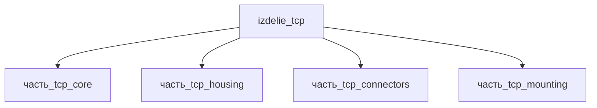

## Описание

TCP (Twisted and Coiled Polymer)

Полное наименование (как в CSV): `TCP (Twisted and Coiled Polymer)`

## Технические характеристики

| Параметр | Значение | Единица | Источник |
|---|---|---|---|
| подсистема | приводная_система | — | canon |
| подтип | прочее | — | canon |
| масса | 0.05–50 (номинал 1) | kg | canon |
| габариты (Д×Ш×В) | 175×20×20 | mm | canon |
| выработка энергии | 0 | W | canon |
| выработка тепла | 0.1–50 | W | canon |
| тип узла | изделие | — | canon |
| уровень_номер | 1 | — | canon |

## Принцип работы

TCP (Twisted and Coiled Polymer) актуатор — искусственная мышца из скрученной и скоиленой
полимерной нити (нейлоновая леска/швейная нить). Нагрев (джоулев или гидро-/термический)
вызывает анизотропное сжатие коила: волокно сокращается до ~49 % длины при нагреве
и развивает удельную работу выше скелетных мышц (Haines et al., Science 2014).
Электропривод: нагрев нити через выводы (connectors), ход передаётся через торцевые
кронштейны (mounting) на нагрузку; рукав (housing) защищает коил и задаёт ось тяги.
Источник: Haines et al., Science 347, 868-872 (2014); https://en.wikipedia.org/wiki/Artificial_muscle (проверено 2026-11-08).

## Состав

Изделие верхнего уровня (TCP-актуатор). Дочерние части:
- часть_tcp_core — коил-волокно TCP (150×3×3 мм), скрученная и скоиленая нейлоновая нить
- часть_tcp_housing — защитный рукав/кожух (173×6×6 мм)
- часть_tcp_connectors — электрические выводы для джоулева нагрева (7.1×7.6×5 мм)
- часть_tcp_mounting — торцевой кронштейн крепления (40×15×6 мм)

## Используемые технологии

- `spiralnaya_navivka` (доля: 1.0)
- `tokarnaya_obrabotka_chpu` (доля: 1.0)
- `lite_pod_davleniem` (доля: 1.0)
- `frezervanie_chpu` (доля: 1.0)

## Используемые материалы

- `neilon_6_66` (форма: connector_housing) → [`neilon_6_66`](../../../материалы/neilon_6_66.md)
- `al_6061-t6` (форма: крепёж_и_монтажные_плиты) → [`al_6061-t6`](../../../материалы/al_6061-t6.md)

## Источники

- CSV: `начальные данные_final.csv` (пользовательский ввод)
- Haines C.S. et al. «Artificial Muscles from Fishing Line and Sewing Thread», Science 347 (2014): https://www.scienceintheclassroom.org/sites/default/files/research-papers/science-2014-haines-868-72.pdf (проверено 2026-11-08)
- Wikipedia Artificial muscle: https://en.wikipedia.org/wiki/Artificial_muscle (проверено 2026-11-08)

---

## Декомпозиция

