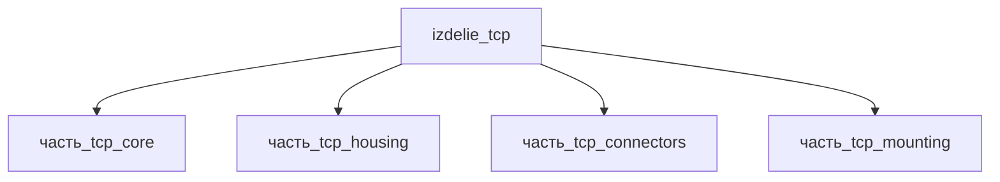

# Изделие: TCP

## Описание

TCP (Twisted and Coiled Polymer)

Полное наименование (как в CSV): `TCP (Twisted and Coiled Polymer)`

## Технические характеристики

| Параметр | Значение | Единица | Источник |
|---|---|---|---|
| подсистема | приводная_система | — | classify_subsystem |
| категория | прочее | — | — |
| габариты (bounding box) | 175 × 20 × 20 | мм | габаритная упаковка детей (Haines 2014) |
| длина волокна (core) | 150 | мм | Wikipedia Artificial muscle / Haines 2014 |
| длина рукава (housing) | 173 | мм | Wikipedia Artificial muscle |

Габариты bounding box приняты по компоновке TCP-актуатора: коил-волокно 150 мм (core)
в защитном рукаве 173 мм (housing), торцевые кронштейны крепления 40×15×6 мм (mounting),
электрические выводы 7.1×7.6×5 мм (connectors). Итог: l=175 мм (рукав 173 + толеранс),
сечение 20×20 мм (кронштейн 15 мм + стенки). Референс: Haines et al., Science 347 (2014),
«Artificial Muscles from Fishing Line and Sewing Thread» (проверено 2026-11-08).

## Состав

Изделие верхнего уровня (TCP-актуатор). Дочерние части:
- часть_tcp_core — коил-волокно TCP (150×3×3 мм), скрученная и скоиленая нейлоновая нить
- часть_tcp_housing — защитный рукав/кожух (173×6×6 мм)
- часть_tcp_connectors — электрические выводы для джоулева нагрева (7.1×7.6×5 мм)
- часть_tcp_mounting — торцевой кронштейн крепления (40×15×6 мм)

## Используемые технологии

(Ссылки на реальные_данные/технологии/ добавляются после связывания)

## Используемые материалы

(Ссылки на реальные_данные/материалы/ добавляются после связывания)

## Принцип работы

TCP (Twisted and Coiled Polymer) актуатор — искусственная мышца из скрученной и скоиленой
полимерной нити (нейлоновая леска/швейная нить). Нагрев (джоулев или гидро-/термический)
вызывает анизотропное сжатие коила: волокно сокращается до ~49 % длины при нагреве
и развивает удельную работу выше скелетных мышц (Haines et al., Science 2014).
Электропривод: нагрев нити через выводы (connectors), ход передаётся через торцевые
кронштейны (mounting) на нагрузку; рукав (housing) защищает коил и задаёт ось тяги.
Источник: Haines et al., Science 347, 868-872 (2014); https://en.wikipedia.org/wiki/Artificial_muscle (проверено 2026-11-08).

## Источники

- CSV: `начальные данные_final.csv` (пользовательский ввод)
- Haines C.S. et al. «Artificial Muscles from Fishing Line and Sewing Thread», Science 347 (2014): https://www.scienceintheclassroom.org/sites/default/files/research-papers/science-2014-haines-868-72.pdf (проверено 2026-11-08)
- Wikipedia Artificial muscle: https://en.wikipedia.org/wiki/Artificial_muscle (проверено 2026-11-08)

---

## Декомпозиция

