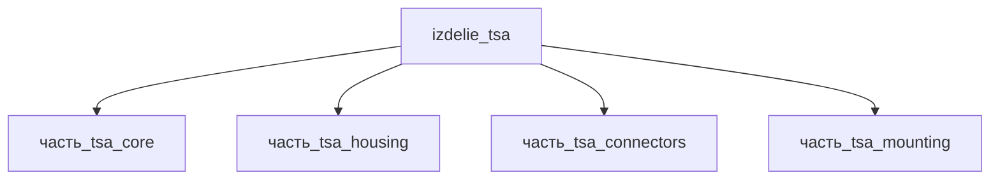

## Описание

TSA (Twisted String Actuator) — твист-струнный привод: электромотор скручивает пучок из 2–4 UHMWPE-шнуров (Spectra/Dyneema), преобразуя вращение в линейное сокращение до 20 % длины при высоком усилии. Модуль: струнный пакет 250 мм (кожух 288×13×13) + моторная головка (maxon DCX-класса с редуктором и энкодером); envelope 350×45×45 мм, масса ~0.3 кг.

Полное наименование (как в CSV): `TSA (Twisted String Actuator)`

## Технические характеристики

| Параметр | Значение | Единица | Источник |
|---|---|---|---|
| подсистема | приводная_система | — | canon |
| подтип | прочее | — | canon |
| масса | 0.1–0.6 (номинал 0.3) | kg | canon |
| габариты (Д×Ш×В) | 350×45×45 | mm | canon |
| выработка энергии | 0 | W | canon |
| выработка тепла | 1–30 | W | canon |
| тип узла | изделие | — | canon |
| уровень_номер | 1 | — | canon |

## Принцип работы

Требует описания на основе инженерного анализа.

## Состав

Изделие верхнего уровня, 4 дочерние части: [`часть_tsa_core`](часть_tsa_core/_index.md) — струнный пакет UHMWPE 250 мм, [`часть_tsa_housing`](часть_tsa_housing/_index.md) — кожух пакета 288 мм, [`часть_tsa_connectors`](часть_tsa_connectors/_index.md) — концевые разъёмы, [`часть_tsa_mounting`](часть_tsa_mounting/_index.md) — крепёж.

## Используемые технологии

- `svivka_shnurov` (доля: 1.0)
- `frezervanie_chpu` (доля: 1.0)
- `tokarnaya_obrabotka_chpu` (доля: 1.0)
- `frezervanie_chpu` (доля: 1.0)

## Используемые материалы

- `uhmwpe` (форма: высоконагруженные_тонкие_шнуры) → [`uhmwpe`](../../../материалы/uhmwpe.md)
- `al_6061-t6` (форма: силовые_элементы_конструкций) → [`al_6061-t6`](../../../материалы/al_6061-t6.md)

## Источники

- CSV: `начальные данные_final.csv` (пользовательский ввод)

---

## Декомпозиция

