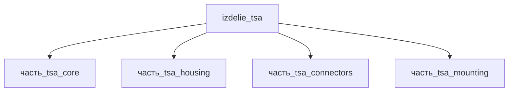

# Изделие: TSA

## Описание

TSA (Twisted String Actuator) — твист-струнный привод: электромотор скручивает пучок из 2–4 UHMWPE-шнуров (Spectra/Dyneema), преобразуя вращение в линейное сокращение до 20 % длины при высоком усилии. Модуль: струнный пакет 250 мм (кожух 288×13×13) + моторная головка (maxon DCX-класса с редуктором и энкодером); envelope 350×45×45 мм, масса ~0.3 кг.

Полное наименование (как в CSV): `TSA (Twisted String Actuator)`

## Технические характеристики

| Параметр | Значение | Единица | Источник |
|---|---|---|---|
| подсистема | приводная_система | — | classify_subsystem |
| категория | прочее | — | — |
| масса (номинал) | 0.3 | kg | Σ детей 0.107 кг + моторная головка (maxon DCX + редуктор ~0.2 кг, Xu 2024 MDPI Actuators 13:477) |
| габариты (Д×Ш×В) | 350×45×45 | mm | струнный пакет housing 288 мм + моторная головка ~60 мм; поперечник по мотору Ø32–40 мм |
| выработка тепла (номинал) | 10 | W | моторные потери при скручивании под нагрузкой |
| выработка тепла (диапазон) | 1–30 | W | от холостого хода до пикового момента |

Envelope родителя синхронизирован с дочерними частями: струнный пакет в кожухе 288×13×13 мм (длиномерная часть привода), концевые разъёмы 23.9×23.9×33 мм, струны UHMWPE 250×10×10 мм. Реальные TSA-модули используют UHMWPE-шнуры Ø1.5 мм с моторами maxon DCX (Xu et al. 2024, MDPI Actuators 13(12):477); комбинация TSA+winch с Dyneema-стрингами — arXiv 2410.12097 (Twisted-Winching String Actuator, 2024).

## Состав

Изделие верхнего уровня, 4 дочерние части: [`часть_tsa_core`](часть_tsa_core/_index.md) — струнный пакет UHMWPE 250 мм, [`часть_tsa_housing`](часть_tsa_housing/_index.md) — кожух пакета 288 мм, [`часть_tsa_connectors`](часть_tsa_connectors/_index.md) — концевые разъёмы, [`часть_tsa_mounting`](часть_tsa_mounting/_index.md) — крепёж.

## Используемые технологии

(Ссылки на реальные_данные/технологии/ добавляются после связывания)

## Используемые материалы

(Ссылки на реальные_данные/материалы/ добавляются после связывания)

## Принцип работы

Требует описания на основе инженерного анализа.

## Источники

- CSV: `начальные данные_final.csv` (пользовательский ввод)

---

## Декомпозиция

