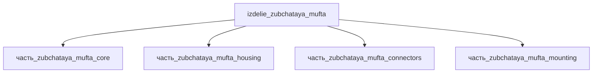

# Изделие: зубчатая муфта

## Описание

Зубчатая муфта (муфта МЗ по ГОСТ 5006-83) — компенсирующая жёсткая муфта для
соединения соосных горизонтальных валов и передачи крутящего момента. Состоит
из двух зубчатых втулок с внешними эвольвентными зубчатыми венцами и обойм с
внутренними зубьями; обоймы соединены болтами и удерживают смазку. Допускает
компенсацию несоосности валов (небольшую угловую и радиальную — за счёт
зубчатого зацепления) при передаче номинального момента. Базовый типоразмер для данного
изделия — муфта 1-1000-40-1У2 ГОСТ 5006-83 (T=1000 Н·м, расточка до 40 мм).

Полное наименование (как в CSV): `зубчатая муфта`

## Технические характеристики

Данные базового типоразмера — муфта 1-1000-40-1У2 (ГОСТ 5006-83, табл. 1, тип 1):

| Параметр | Значение | Единица | Источник |
|---|---|---|---|
| Номинальный крутящий момент | 1000 | Н·м | ГОСТ 5006-83, табл. 1 |
| Наибольший диаметр расточки d | 40 | мм | ГОСТ 5006-83, табл. 1 |
| Наружный диаметр обоймы D | 145 | мм | ГОСТ 5006-83, табл. 1 |
| Длина ступицы l (не более) | 82 | мм | ГОСТ 5006-83, табл. 1 |
| Общая длина муфты L (не более) | 174 | мм | ГОСТ 5006-83, табл. 1 |
| Масса (не более) | 6.7 | кг | ГОСТ 5006-83, табл. 1 |
| Модуль зуба / число зубьев | 2.5 / 30 | мм / шт | ГОСТ 5006-83, приложение |
| подсистема | приводная_система | — | classify_subsystem |

Габаритный конверт изделия (l×w×h = 174×145×145 мм) принят по длине L и
наружному диаметру D обоймы базового типоразмера: все дочерние части
(наибольшая — корпус-обойма 92×92×69 мм) размещаются в конверте с запасом
(объёмный чек: V(конверта) = 3.66·10⁶ мм³ ≥ 1.22·10⁶ мм³ = Σ V(детей)×1.15).

## Состав

- `часть_zubchataya_mufta_core` — зубчатые втулки (ведущая/ведомая), сталь Ст3
- `часть_zubchataya_mufta_housing` — корпус-обойма, сплав Al 6061-T6
- `часть_zubchataya_mufta_connectors` — соединители (болты/шпонки), Al 6061-T6
- `часть_zubchataya_mufta_mounting` — монтажные элементы, сталь Ст3

## Используемые технологии

(Ссылки на реальные_данные/технологии/ добавляются после связывания)

## Используемые материалы

- `stal_st3` → [`stal_st3.md`](../../../материалы/stal_st3.md) — зубчатые втулки, монтажные элементы
- `al_6061-t6` → [`al_6061-t6.md`](../../../материалы/al_6061-t6.md) — корпус-обойма, соединители

## Принцип работы

Крутящий момент передаётся от ведущего вала через шпоночное/шлицевое
соединение на зубчатую втулку с внешним венцом; венец входит в зацепление с
внутренними зубьями обоймы, жёстко связанной болтами со второй обоймой, от
которой момент уходит на ведомую втулку и ведомый вал. Эвольвентные зубья с
боковым зазором допускают небольшие угловые, радиальные и осевые смещения
валов без излома момента; полость обойм заполняется пластичной смазкой,
удерживаемой уплотнениями, что снижает износ зубьев.

## Источники

- ГОСТ 5006-83 «Муфты зубчатые. Технические условия» (табл. 1, тип 1:
  D=145 мм, L=174 мм, масса ≤6.7 кг) — https://files.stroyinf.ru/Data2/1/4294823/4294823655.pdf (обращение 2026-11-07)
- Зубчатые муфты МЗ (крановый ряд, модуль/число зубьев) — https://xn--80aqy.com.ua/dlya-krana/mufta-zub-mz (обращение 2026-11-07)
- CSV: `начальные данные_final.csv` (пользовательский ввод)

---

## Декомпозиция

