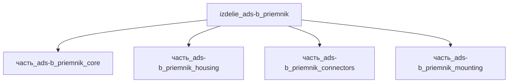

# Изделие: ADS-B приёмник

## Описание

Бортовой приёмник ADS-B (Automatic Dependent Surveillance–Broadcast, ADS-B In) для приёма телеметрии окружающих воздушных судов на 1090 МГц (Extended Squitter) и/или 978 МГц (UAT) — детект-энд-эвойд сенсор БПЛА. Референсные исполнения — миниатюрный UAS-приёмник uAvionix pingRX Pro (32×31×9 мм, 8 г, 4–6 В / 150 мА → 0.75 Вт) и USB-приёмник класса RTL-SDR/FlightAware (~1.4 Вт при 270–280 мА × 5 В); канон изделия (номинал массы 0.5 кг) соответствует бортовому приёмнику с интерфейсной обработкой MAVLink/RS-232.

Полное наименование (как в CSV): `ADS-B приёмник`

## Технические характеристики

| Параметр | Значение | Единица | Источник |
|---|---|---|---|
| подсистема | сенсоры | — | classify_subsystem |
| категория | оптика | — | canon (YAML) |
| масса | 0.05–5 (номинал 0.5) | kg | канон изделия |
| выработка тепла | 0.1–10 (номинал 2.0) | W | Q = Pэл приём-only прибора — см. обоснование теплового баланса |
| питание | 4–6 / 11–33 | В DC | uAvionix pingRX Pro (4–6 В / 150 мА); ping200X FAQ (11–33 В) |

## Состав

Изделие верхнего уровня (уровень 1) из 4 частей уровня 2 — приёмный тракт `часть_ads-b_priemnik_core`, корпус `часть_ads-b_priemnik_housing`, комплект разъёмов `часть_ads-b_priemnik_connectors`, монтажная траверса `часть_ads-b_priemnik_mounting`.

## Используемые технологии

(Ссылки на реальные_данные/технологии/ добавляются после связывания)

## Используемые материалы

(Ссылки на реальные_данные/материалы/ добавляются после связывания)

## Принцип работы

Принимает сигналы ADS-B окружающих воздушных судов на 1090 МГц (Extended Squitter) и/или 978 МГц (UAT): антенный тракт (SMA/MCX) → малошумящий РЧ-фронтенд и тюнер → демодулятор и декодирование Mode S/ES-пакетов → передача данных автопилоту по RS-232/MAVLink для отображения трафика и алгоритмов sense-and-avoid. Приём-only устройство — не излучает; вся потребляемая электрическая мощность (номинал 2.0 Вт) рассеивается в виде тепла, основная часть — в приёмном тракте (core ~1.0 Вт), отвод тепла — корпусом-радиатором.

## Источники

- CSV: `начальные данные_final.csv` (пользовательский ввод)
- uAvionix pingRX Pro — спецификация приёмника ADS-B In (32×31×9 мм, 8 г, 4–6 В / 150 мА → 0.75 Вт) — https://uavionix.com/product/pingrx-pro/ (обращение 2026-11-08)
- uAvionix pingRX Pro Quick Start Guide — Input Voltage/Power 4–6 В / 150 мА — https://uavionix.com/wp-content/uploads/dlm_uploads/2024/12/pingRX-Pro_Quick_Start_Guide.pdf (обращение 2026-11-08)
- RTL-SDR Blog V3 datasheet — типовой потребляемый ток 270–280 мА при 5 В USB → ~1.4 Вт — https://www.rtl-sdr.com (обращение 2026-11-08)

---

## Декомпозиция

