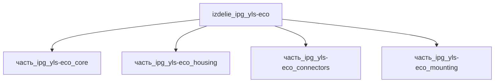

## Описание

IPG YLS-ECO — волоконный лазер

Полное наименование (как в CSV): `IPG YLS-ECO — волоконный лазер`

## Технические характеристики

| Параметр | Значение | Единица | Источник |
|---|---|---|---|
| подсистема | сенсоры | — | canon |
| подтип | прочее | — | canon |
| масса | 50.0–500.0 (номинал 380.0) | kg | canon |
| габариты (Д×Ш×В) | 860×810×1210 | mm | canon |
| выработка энергии | 0 | W | canon |
| выработка тепла | 0.1–10 | W | canon |
| тип узла | изделие | — | canon |
| уровень_номер | 1 | — | canon |

## Принцип работы

Требует описания на основе инженерного анализа.

## Состав

Изделие верхнего уровня. Дочерние части не указаны (требуется декомпозиция).

## Используемые технологии

- `frezervanie_chpu` (доля: 1.0)
- `anodirovanie` (доля: 1.0)

## Используемые материалы

- `stal_st3` (форма: силовые_элементы_конструкций) → [`stal_st3`](../../../материалы/stal_st3.md)
- `aluminum` (форма: корпуса_электроники) → [`aluminum`](../../../материалы/aluminum.md)

## Источники

- CSV: `начальные данные_final.csv` (пользовательский ввод)

---

## Декомпозиция

