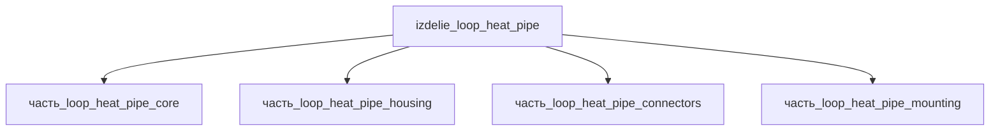

# Изделие: Loop Heat Pipe

## Описание

Loop Heat Pipe (LHP) — пассивное двухфазное устройство переноса тепла с капиллярным фитилём в испарителе: тепло от источника испаряет рабочую жидкость, пар движется по паровой линии к конденсатору, конденсат возвращается по жидкостной линии за счёт капиллярного давления фитиля. Плоский LHP (испаритель 150×80 мм, envelope 200×100×70 мм) переносит до ~130 Вт; масса ~0.6 кг (алюминиевый корпус ~500 г в аналогичных конструкциях, Ku et al. 2004).

Полное наименование (как в CSV): `Loop Heat Pipe (LHP)`

## Технические характеристики

| Параметр | Значение | Единица | Источник |
|---|---|---|---|
| подсистема | система_охлаждения | — | classify_subsystem |
| категория | прочее | — | — |
| масса (номинал) | 0.6 | kg | Σ детей 0.565 кг + паровая/жидкостная линии, рабочая жидкость; аналогичный алюминиевый корпус ~500 г (Ku 2004) |
| габариты (Д×Ш×В) | 200×100×70 | mm | envelope: корпус housing 173×92×35 + петля паровая/жидкостная линии (перевышение над плоской базой) |
| транспортная тепловая мощность (номинал) | 130 | W | плоский LHP: Qmax = 131.8 Вт (Flat plate LHP with novel evaporator structure, ResearchGate 4134331); аналоги 120–140 Вт (Ku 2004) |
| транспортная тепловая мощность (диапазон) | 20–200 | W | от противонаклонной ориентации до max; NASA Heat Pipes Short Course (TFAWS) |
| выработка энергии | 0 | W | пассивное устройство, без внешнего питания |

LHP сам не генерирует тепло — поле `выработка_тепла_W` отражает переносимую тепловую мощность (transport capacity), которая должна покрывать Σ тепловыделения всех дочерних частей (испаритель core 1.0 Вт, разъёмы connectors 0.1 Вт). Qmax = 131.8 Вт подтверждён для плоского LHP сопоставимого размера (испаритель 90–150 мм); диапазон зависит от ориентации и температурного диапазона 40–150 °C (Heat Pipe Loop, NASA).

## Состав

Изделие верхнего уровня, 4 дочерние части: [`часть_loop_heat_pipe_core`](часть_loop_heat_pipe_core/_index.md) — испаритель с капиллярным фитилём, [`часть_loop_heat_pipe_housing`](часть_loop_heat_pipe_housing/_index.md) — корпус, [`часть_loop_heat_pipe_connectors`](часть_loop_heat_pipe_connectors/_index.md) — разъёмы/штуцеры, [`часть_loop_heat_pipe_mounting`](часть_loop_heat_pipe_mounting/_index.md) — крепёж.

## Используемые технологии

(Ссылки на реальные_данные/технологии/ добавляются после связывания)

## Используемые материалы

(Ссылки на реальные_данные/материалы/ добавляются после связывания)

## Принцип работы

Капиллярная петля: фитиль испарителя (никель/медь, пористость 0.6–0.8) создаёт капиллярное давление, прокачивающее рабочую жидкость (аммиак/метанол/вода) по замкнутому контуру «испаритель → паровая линия → конденсатор → жидкостная линия → компенсационная полость». Работает без внешнего питания в любой ориентации, включая противогравитационную (при adverse gravity capability снижается до 5–12 Вт); перенос тепла практически изотермичен (ΔT < 2–5 °C по линии).

## Источники

- CSV: `начальные данные_final.csv` (пользовательский ввод)

---

## Декомпозиция

