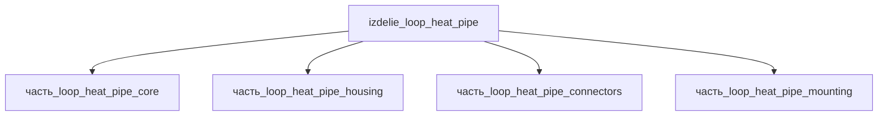

## Описание

Loop Heat Pipe (LHP) — пассивное двухфазное устройство переноса тепла с капиллярным фитилём в испарителе: тепло от источника испаряет рабочую жидкость, пар движется по паровой линии к конденсатору, конденсат возвращается по жидкостной линии за счёт капиллярного давления фитиля. Плоский LHP (испаритель 150×80 мм, envelope 200×100×70 мм) переносит до ~130 Вт; масса ~0.6 кг (алюминиевый корпус ~500 г в аналогичных конструкциях, Ku et al. 2004).

Полное наименование (как в CSV): `Loop Heat Pipe (LHP)`

## Технические характеристики

| Параметр | Значение | Единица | Источник |
|---|---|---|---|
| подсистема | система_охлаждения | — | canon |
| подтип | прочее | — | canon |
| масса | 0.4–1.2 (номинал 0.6) | kg | canon |
| габариты (Д×Ш×В) | 200×100×70 | mm | canon |
| выработка энергии | 0 | W | canon |
| выработка тепла | 20–200 | W | canon |
| тип узла | изделие | — | canon |
| уровень_номер | 1 | — | canon |

## Принцип работы

Капиллярная петля: фитиль испарителя (никель/медь, пористость 0.6–0.8) создаёт капиллярное давление, прокачивающее рабочую жидкость (аммиак/метанол/вода) по замкнутому контуру «испаритель → паровая линия → конденсатор → жидкостная линия → компенсационная полость». Работает без внешнего питания в любой ориентации, включая противогравитационную (при adverse gravity capability снижается до 5–12 Вт); перенос тепла практически изотермичен (ΔT < 2–5 °C по линии).

## Состав

Изделие верхнего уровня, 4 дочерние части: [`часть_loop_heat_pipe_core`](часть_loop_heat_pipe_core/_index.md) — испаритель с капиллярным фитилём, [`часть_loop_heat_pipe_housing`](часть_loop_heat_pipe_housing/_index.md) — корпус, [`часть_loop_heat_pipe_connectors`](часть_loop_heat_pipe_connectors/_index.md) — разъёмы/штуцеры, [`часть_loop_heat_pipe_mounting`](часть_loop_heat_pipe_mounting/_index.md) — крепёж.

## Используемые технологии

- `tokarnaya_obrabotka_chpu` (доля: 1.0)
- `frezervanie_chpu` (доля: 1.0)

## Используемые материалы

- `stal_st3` (форма: валы_оси_и_токарные_детали) → [`stal_st3`](../../../материалы/stal_st3.md)
- `al_6061-t6` (форма: корпуса_электроники) → [`al_6061-t6`](../../../материалы/al_6061-t6.md)

## Источники

- CSV: `начальные данные_final.csv` (пользовательский ввод)

---

## Декомпозиция

