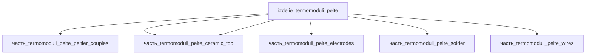

# Изделие: термомодули Пельтье

## Описание

термомодули Пельтье

Полное наименование (как в CSV): `термомодули Пельтье`

## Технические характеристики

| Параметр | Значение | Единица | Источник |
|---|---|---|---|
| подсистема | энергетическая | — | classify_subsystem |
| категория | прочее | — | — |

(Параметры требуют уточнения через веб-поиск и вычислений; см. fc_изделие_масса, fc_изделие_стандарты в _field_contracts.yaml)

## Состав

Изделие верхнего уровня — однокаскадный термомодуль Пельтье 40×40 мм (127 пар Bi2Te3, керамика Al2O3 96 %, медные электроды, пайка Sn-Pb, медные токоподводы). Пять составных частей:

- `часть_termomoduli_pelte_peltier_couples` — p/n-термоэлементы (127 пар Bi2Te3);
- `часть_termomoduli_pelte_ceramic_top` — керамические пластины Al2O3 (верх/низ, ×2);
- `часть_termomoduli_pelte_electrodes` — медные коммутационные электроды;
- `часть_termomoduli_pelte_solder` — паяные соединения Sn-Pb;
- `часть_termomoduli_pelte_wires` — медные токоподводящие провода.

## Используемые технологии

(Ссылки на реальные_данные/технологии/ добавляются после связывания)

## Используемые материалы

(Ссылки на реальные_данные/материалы/ добавляются после связывания)

## Принцип работы

Требует описания на основе инженерного анализа.

## Источники

- CSV: `начальные данные_final.csv` (пользовательский ввод)

---

## Декомпозиция

