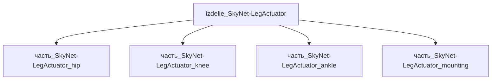

## Описание

Гуманоидный нога-привод (leg actuator assembly): модуль из 3 сочленений (тазобедренное hip, коленное knee, голеностопное ankle) с BLDC-моторами + harmonic-drive редукторами, формирующий одну ногу гуманоидной платформы класса Atlas/Optimus. Аналог энергоблока SkyNet-гуманоидов (T700/T900/T950/TRIP): 6 степеней свободы на ногу, пиковый момент 220 Нм на hip, работа до 4 часов от батарейного рюкзака. Envelope модуля 380×180×120 мм, масса 3.5 кг (пара ног — 7 кг из ~75 кг корпуса робота).

Родитель: верхний уровень иерархии (подсистема: `система_передвижения`).

## Технические характеристики

| Параметр | Значение | Единица | Источник |
|---|---|---|---|
| подсистема | система_передвижения | — | canon |
| подтип | привод_конечности | — | canon |
| масса | 1.5–6.0 (номинал 3.5) | kg | canon |
| габариты (Д×Ш×В) | 380×180×120 | mm | canon |
| выработка энергии | 0–0 | W | canon |
| выработка тепла | 50–800 | W | canon |
| тип узла | изделие | — | canon |
| уровень_номер | 1 | — | canon |

## Принцип работы

Каждое сочленение — модульная сборка «BLDC + strain-wave (harmonic) редуктор + torque sensor + absolute encoder»: мотор разгоняется до 9000 об/мин, harmonic drive (ratio 100–160:1) снижает до 60–90 об/мин на выходе с моментом 100–220 Нм. Контроллер FOC (field-oriented control) на 400 Гц с датчиком тока и момента закрывает петлю обратной связи; trajectory-planner верхнего уровня выдаёт целевые углы суставов с частотой 1 кГц. Гуманоидная походка поддерживается баланс-контроллером (MPC + ZMP). Источник: Boston Dynamics Atlas spec sheet + humanoid.guide (актyator commonality).

## Состав

Изделие уровня 1, состоит из 4 дочерних частей (hip, knee, ankle, mounting). Каждое сочленение — отдельныйservo-узел; mounting-часть включает интерфейс к тазовому/стопному фланцам.

## Используемые технологии

- `frezervanie_chpu` (доля: 1.0)
- `ebw` (доля: 1.0)
- `frezervanie_chpu` (доля: 1.0)
- `shtampovka_listovaya` (доля: 1.0)

## Используемые материалы

- `al_6061-t6` (форма: силовые_элементы_конструкций) → [`al_6061-t6`](../../../материалы/al_6061-t6.md)
- `ti-6al-4v` (форма: планер_и_космические_изделия) → [`ti-6al-4v`](../../../материалы/ti-6al-4v.md)
- `al_6061-t6` (форма: корпуса_электроники) → [`al_6061-t6`](../../../материалы/al_6061-t6.md)
- `ss_aisi_304` (форма: крепёж_пружины_холоднодеформ) → [`ss_aisi_304`](../../../материалы/ss_aisi_304.md)

## Источники

- Канон: декомпозиция SkyNet-гуманоидных моделей (web_search 2026-11-05)
- Boston Dynamics Atlas (electric): https://bostondynamics.com/products/atlas
- Humanoid actuator commonality: https://humanoid.guide/humanoid-actuator-commonality
- Материалы: реальные данные/материалы/

## Декомпозиция

