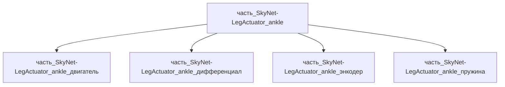

# Часть: часть_SkyNet-LegActuator_ankle

## Описание

Голеностопный привод (ankle actuator): двухосевой дифференциальный привод (pitch+roll) с BLDC меньшего габарита, корпус 6061-T6, момент ~120 Н·м. Масса 0.875 кг (25% родителя) — по пропорции приводов Atlas (90 кг робот, 2.3 м reach).

Родитель: `izdelie_SkyNet-LegActuator` (подсистема: система_передвижения).

## Технические характеристики

| Параметр | Значение | Единица | Источник |
|---|---|---|---|
| подсистема | система_передвижения | — | canon |
| подтип | привод_конечности | — | canon |
| масса | 0.875 | kg | Boston Dynamics Atlas spec sheet (90 kg, payload 50 kg); Unitree H1 (knee 360 N·m, 47 kg) |
| доля массы родителя | 0.25 | — | материалы_частей `izdelie_SkyNet-LegActuator` |
| габариты (Д×Ш×В) | 120×90×80 | mm | Boston Dynamics Atlas spec sheet (90 kg, payload 50 kg); Unitree H1 (knee 360 N·m, 47 kg) |
| выработка энергии | 0 | W | canon |
| выработка тепла | 150 | W | Boston Dynamics Atlas spec sheet (90 kg, payload 50 kg); Unitree H1 (knee 360 N·m, 47 kg) |
| материал | al_6061-t6 (корпус привода); форма: корпуса_электроники | — | CNC-корпуса актуаторов роботов — отраслевой стандарт 6061-T6 (XinqiDa CNC, Rivcut); пиковый момент голеностопа гуманоида 100–150 Н·м (Firgelli) |

## Принцип работы

Два коаксиальных BLDC через конический дифференциал управляют тангажом и креном стопы — активная адаптация к рельефу без датчиков касания; упругий элемент (серия C) в пятке гасит удар при постановке стопы.

## Состав

Промежуточная часть (уровень 2), СТРАТЕГИЯ B чек-листа F34: 4 неделимых узла уровня 3 — двигатель (2× коаксиальных BLDC), дифференциал (конический), энкодер (2× абсолютных магнитных), пружина (series-elastic торсионная серия C); корпус — интегральное тело модуля в собственном BOM. Баланс: V(модуля)=864 000 мм³ ≥ ΣV(детей)×1.15=440 100 мм³; тепло 150 Вт = 130 (двигатель) + 20 (дифференциал).

## Используемые материалы

- `al_6061-t6` → [`al_6061-t6.md`](../../../../материалы/al_6061-t6.md) — форма: `корпуса_электроники`

Форма материала: **фрезерованный корпус двухосевого дифференциального привода** (`корпуса_электроники`). Обработка резанием из плиты/прутка 6061-T6 — отраслевой стандарт корпусов сервоприводов и робототехнических motion-модулей: баланс жёсткости и массы, точные посадочные стаканы подшипников BLDC (класс допусков ±0.01 мм), отвод тепла 150 Вт через стенки корпуса (k 152–167 Вт/(м·К) — втрое выше нержавеющих сталей), твёрдое анодирование Type III износостойких посадочных поверхностей. Пиковый момент ~120 Н·м лежит в референсном диапазоне гуманоидных актуаторов основных суставов 100–150 Н·м (Firgelli); ударные нагрузки при постановке стопы — типовой режим «impact resistance» голеностопных актуаторов (CubeMars).

## Источники

- Boston Dynamics Atlas spec sheet (90 kg, payload 50 kg); Unitree H1 (knee 360 N·m, 47 kg): https://bostondynamics.com/wp-content/uploads/2026/01/atlas-spec-sheet.pdf (проверено 2026-11-05)
- XinqiDa CNC Machining: CNC Linear Actuator Housing — Custom Aluminum High-Precision CNC-Machined for Robotic Motion Module (корпус 6061-T6: баланс лёгкости и конструкционной жёсткости для робототехнических motion-модулей): https://www.xinqidamachining.com/product/cnc-linear-actuator-housing-custom-aluminum-high-precision-cnc-machined-for-robotic-motion-module/ (проверено 2026-11-08)
- Rivcut CNC Machining (Houston, TX): CNC Machined Actuator Housings — обработка aluminum 6061/7075, анодированный алюминий для корпусов сервомоторов и редукторов: https://www.rivcut.com/cnc-machining/houston/robotics/actuator-housings (проверено 2026-11-08)
- CubeMars: Robotic Ankle Joint Motor for Humanoids & Exoskeletons — высокомоментные голеностопные актуаторы, стойкость к ударным нагрузкам (impact resistance) в двухногоих роботах: https://www.cubemars.com/categorys/ankle-joint-motor (проверено 2026-11-08)
- Firgelli Automations: Humanoid Robot Actuators — The Complete Engineering Guide — пиковый момент основных суставов гуманоида (включая голеностоп) 100–150 Н·м: https://www.firgelli.com/pages/humanoid-robot-actuators (проверено 2026-11-08)
- Материалы: реальные данные/материалы/

---

## Декомпозиция

