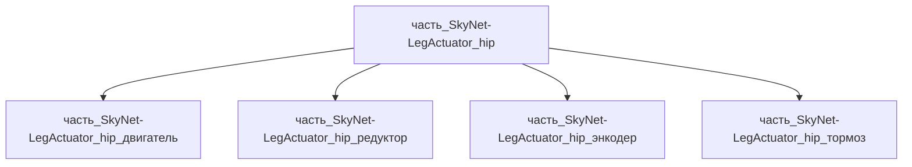

# Часть: часть_SkyNet-LegActuator_hip

## Описание

Тазобедренный привод ноги (hip actuator): высокомоментный BLDC 48 В с планетарным редуктором 1:21 в корпусе из алюминия 6061-T6, пик момента ≈360 Н·м (уровень коленного привода Unitree H1), встроенный абсолютный энкодер и тормоз. Масса 1.225 кг (35% родителя 3.5 кг) — пропорция по Atlas spec sheet (приводы ≈половина массы робота 90 кг, 6 степеней на ногу). Декомпозирован (СТРАТЕГИЯ B, F34): 4 неделимых узла уровня 3 — двигатель BLDC, планетарный редуктор 1:21, абсолютный энкодер, пружинный тормоз; корпус — интегральное тело модуля.

Родитель: `izdelie_SkyNet-LegActuator` (подсистема: система_передвижения).

## Технические характеристики

| Параметр | Значение | Единица | Источник |
|---|---|---|---|
| подсистема | система_передвижения | — | canon |
| подтип | привод_конечности | — | canon |
| масса | 1.225 | kg | Boston Dynamics Atlas spec sheet (90 kg, payload 50 kg); Unitree H1 (knee 360 N·m, 47 kg) |
| доля массы родителя | 0.35 | — | материалы_частей `izdelie_SkyNet-LegActuator` |
| габариты (Д×Ш×В) | 150×120×110 | mm | Boston Dynamics Atlas spec sheet (90 kg, payload 50 kg); Unitree H1 (knee 360 N·m, 47 kg) |
| выработка энергии | 0 | W | canon |
| выработка тепла | 300 | W | Boston Dynamics Atlas spec sheet (90 kg, payload 50 kg); Unitree H1 (knee 360 N·m, 47 kg) |
| материал | al_6061-t6 (форма: корпуса_электроники; корпус модуля, доля 0.10) | — | al_6061-t6.md |
| наследуемые материалы | copper 0.42 / 100cr6 0.31 / al_6061-t6 0.065 / spring_steel 0.105 | — | наследуемые_материалы (BOM детей) |
| декомпозиция | 4 части: двигатель / редуктор / энкодер / тормоз (уровень 3) | — | F34 СТРАТЕГИЯ B |

## Принцип работы

Трёхфазный BLDC с FOC-управлением передаёт момент через планетарный редуктор на рычаг бедра; квази-прямой привод (low-ratio) допускает обратный привод для impedance-контроля шага. Тепло 300 Вт пик отводится корпусом в каркас.

## Состав

Промежуточная часть (уровень 2): 4 неделимых узла уровня 3 — двигатель (BLDC 48 В, IPM-ротор, медные обмотки, 0.51 кг), редуктор (двухступенчатый планетарный 1:21, 100Cr6, 0.38 кг), энкодер (абсолютный магнитный, al_6061-t6, 0.08 кг), тормоз (пружинный нормально-замкнутый, spring steel, 0.13 кг) + корпус модуля как интегральное тело (al_6061-t6, 0.12 кг). Вложенная coaxial-геометрия: редуктор 35 + двигатель 40 + тормоз 20 = 95 мм ≤ 110 мм оси.

## Используемые материалы

- `al_6061-t6` → [`al_6061-t6.md`](../../../../материалы/al_6061-t6.md)

## Источники

- Boston Dynamics Atlas spec sheet (90 kg, payload 50 kg); Unitree H1 (knee 360 N·m, 47 kg): https://bostondynamics.com/wp-content/uploads/2026/01/atlas-spec-sheet.pdf (проверено 2026-11-05)
- Материалы: реальные данные/материалы/

## Декомпозиция

