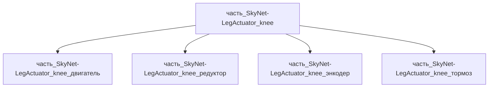

# Часть: часть_SkyNet-LegActuator_knee

## Описание

Коленный привод ноги (knee actuator): BLDC + редуктор 1:16 в титановом корпусе Ti-6Al-4V (внешняя оболочка редуктора — силовой элемент, воспринимает изгиб при опорной фазе), пик момента 360 Н·м как у колена Unitree H1. Масса 1.05 кг (30% родителя). Декомпозирован (СТРАТЕГИЯ B, F34): 4 неделимых узла уровня 3 — двигатель BLDC, двухступенчатый эпициклический редуктор 1:16 с полым валом, абсолютный магнитный энкодер (dual encoder у мотора M107 Unitree H1), пружинный тормоз; титановый корпус — интегральная силовая оболочка модуля.

Родитель: `izdelie_SkyNet-LegActuator` (подсистема: система_передвижения).

## Технические характеристики

| Параметр | Значение | Единица | Источник |
|---|---|---|---|
| подсистема | система_передвижения | — | canon |
| подтип | привод_конечности | — | canon |
| масса | 1.05 | kg | Unitree H1 — Universal humanoid robot (knee 360 N·m, 47 kg) |
| доля массы родителя | 0.3 | — | материалы_частей `izdelie_SkyNet-LegActuator` |
| габариты (Д×Ш×В) | 140×100×100 | mm | Unitree H1 — Universal humanoid robot (knee 360 N·m, 47 kg) |
| выработка энергии | 0 | W | canon |
| выработка тепла | 250 | W | Unitree H1 — Universal humanoid robot (knee 360 N·m, 47 kg) |
| материал | ti-6al-4v (форма: планер_и_космические_изделия; корпус модуля, доля 0.14) | — | ti-6al-4v.md |
| наследуемые материалы | copper 0.40 / 100cr6 0.30 / al_6061-t6 0.05 / spring_steel 0.11 | — | наследуемые_материалы (BOM детей) |
| декомпозиция | 4 части: двигатель / редуктор / энкодер / тормоз (уровень 3) | — | F34 СТРАТЕГИЯ B |

## Принцип работы

Коленный шарнир с моментом 360 Н·м (данные Unitree H1) держит приседание робота 90 кг (Atlas); титановый корпус снижает массу на 40% против стали при равной жёсткости. Выход — двухэпициклический редуктор с полым валом для трассы кабелей.

## Состав

Промежуточная часть (уровень 2): 4 неделимых узла уровня 3 — двигатель (BLDC 48 В, IPM-ротор, медные обмотки, 0.42 кг), редуктор (двухступенчатый эпициклический 1:16 с полым выходным валом, 100Cr6, 0.32 кг), энкодер (абсолютный магнитный, al_6061-t6, 0.05 кг), тормоз (пружинный нормально-замкнутый, spring steel, 0.12 кг) + титановый корпус модуля как интегральное тело (ti-6al-4v, 0.15 кг). Вложенная coaxial-геометрия: редуктор 32 + двигатель 38 + тормоз 18 = 88 мм ≤ 100 мм оси.

## Используемые материалы

- `ti-6al-4v` → [`ti-6al-4v.md`](../../../материалы/ti-6al-4v.md)

## Источники

- Unitree H1 — Universal humanoid robot (knee 360 N·m, 47 kg): https://www.unitree.com/mobile/h1 (проверено 2026-11-05)
- Unitree H1 SDK Development Guide (мотор M107: 360 Н·м, dual encoder): https://support.unitree.com/home/en/H1_SDK_Development_Guide (проверено 2026-11-08)
- Материалы: реальные данные/материалы/

## Декомпозиция

