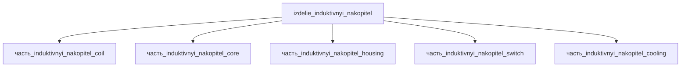

# Изделие: Индуктивный накопитель

## Описание

Индуктивный накопитель

Полное наименование (как в CSV): `Индуктивный накопитель`

## Технические характеристики

| Параметр | Значение | Единица | Источник |
|---|---|---|---|
| подсистема | энергетическая | — | classify_subsystem |
| категория | прочее | — | — |

(Параметры требуют уточнения через веб-поиск и вычислений; см. fc_изделие_масса, fc_изделие_стандарты в _field_contracts.yaml)

## Состав

Изделие верхнего уровня. Дочерние части: `часть_induktivnyi_nakopitel_coil` (сверхпроводящая REBCO-катушка), `часть_induktivnyi_nakopitel_core` (ламинированный магнитопровод), `часть_induktivnyi_nakopitel_housing` (несущий корпус), `часть_induktivnyi_nakopitel_switch` (коммутатор заряда/разряда), `часть_induktivnyi_nakopitel_cooling` (GM-криоохладитель).

## Используемые технологии

(Ссылки на реальные_данные/технологии/ добавляются после связывания)

## Используемые материалы

(Ссылки на реальные_данные/материалы/ добавляются после связывания)

## Принцип работы

Требует описания на основе инженерного анализа.

## Источники

- CSV: `начальные данные_final.csv` (пользовательский ввод)
- Tixador P. (IEEE CSC slides CR5, 2008) — состав SMES-системы: сверхпроводящая катушка + криогенная система (криостат, вакуумные насосы, криоохладитель) + преобразователь; удельная энергия порядка 10 кДж/кг: https://snf.ieeecsc.org/files/ieeecsc/slides/CR5_Final3_012008.pdf (обращение 2026-11-09)
- Ciceron J., Badel A., Tixador P. — Superconducting energy storage (EPJ Appl. Phys. 80, 20901, 2017) — 1 МДж SMES, удельная энергия 20 кДж/кг: https://www.epjap.org/articles/epjap/full_html/2017/11/ap160452/ap160452.html (обращение 2026-11-09)

---

## Декомпозиция

