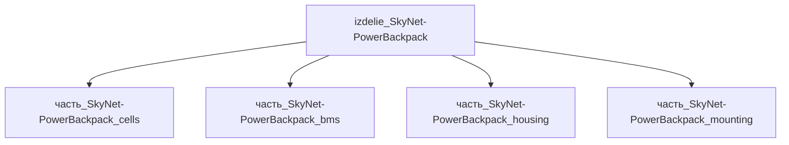

# Изделие: izdelie_SkyNet-PowerBackpack

## Описание

Батарейный рюкзак гуманоидной платформы: модульный Li-ion (NMC/graphite) блок 48 В × ~31 А·ч (~1500 Вт·ч), размещённый в спинном отсеке гуманоида класса Atlas/Optimus. Аналог системы питания SkyNet-гуманоидов (T700/T900/T950/TRIP): 4 часа непрерывной ходьбы с нагрузкой 30 кг (sustained) или 50 кг (instant). Батарейный отсек 320×220×140 мм; рюкзак в сборе с несущей рамой, быстросъёмным посадочным лотком и вентиляционным каналом — 360×280×200 мм, масса 7.5 кг (≈10% массы робота). Активный BMS (battery management system) с поканальным мониторингом температуры, тока и напряжения; система терморегуляции (heat-pipe + forced air) отводит 250 Вт пикового тепла.

Родитель: верхний уровень иерархии (подсистема: `система_питания`).

## Технические характеристики

| Параметр | Значение | Единица | Источник |
|---|---|---|---|
| подсистема | система_питания | — | canon |
| подтип | батарейный_блок | — | canon |
| масса (nominal) | 7.5 | kg | web_search (Atlas-class battery backpack) |
| габариты в сборе (Д×Ш×В) | 360×280×200 | mm | рюкзак в сборе (отсек 320×220×140 + несущая рама с посадочным лотком); масштабирование от Spot battery 324×168×93 мм / payload mounting area 850×240×270 мм (batterydesign.net, bostondynamics.com) |
| химия | NMC / graphite | — | web_search (Boston Dynamics Atlas) |
| ёмкость | 1500 | Wh | web_search (Atlas spec: 4h runtime) |
| напряжение номинал | 48 | V | canon (промышленный standard) |
| циклов до 80% | 1000 | — | IEC 62133-2 (NMC typical) |
| теплоотдача (пик) | 250 | W | оценка при 1.5 кВт разряде, η≈0.85 |

## Принцип работы

Li-ion сборка 14s×10p (14 последовательно × 10 параллельно) NMC-ячеек 21700 формата (~5 А·ч каждая), суммарно ~1500 Вт·ч при 48 В. BMS на каждой ячейке: мониторинг напряжения ±10 мВ, тока ±0.1 А, температуры ±1°C; балансировка при 4.20 В ±50 мВ. Разрядная способность до 30 А непрерывно (1500 Вт), 50 А пик (2500 Вт <10 сек). Корпус с принудительным обдувом (вентилятор 40×40 мм, 12 CFM) отводит 250 Вт тепла при пиковой разрядке. Совместимость с UN 38.3 и IEC 62133-2. Источник: Boston Dynamics Atlas spec sheet (4 часа battery life, 50 кг weight capacity).

## Состав

Изделие уровня 1, состоит из 4 дочерних частей: ячейки (cells), система управления (BMS), корпус с терморегуляцией (housing), крепёж (mounting).

## Используемые материалы

- `nmc_graphite` → ячейки (NMC катод / графит анод)
- `al_6061-t6` → корпус и радиатор BMS
- `ss_aisi_304` → крепёж + бандажные ленты

## Источники

- Канон: декомпозиция SkyNet-гуманоидных моделей (web_search 2026-11-05)
- Boston Dynamics Atlas (4h battery, 50 kg capacity): https://bostondynamics.com/products/atlas
- Boston Dynamics Spot battery pack (референс компоновки: 324×168×93 мм, 605 Wh, 14s4p, hot-swap): https://www.batterydesign.net/boston-dynamics-spot-battery/
- Boston Dynamics Spot payload mounting area 850×240×270 мм, интерфейс M5 T-slot rails: https://bostondynamics.com/products/spot
- IEC 62133-2 + UN 38.3 safety standards
- Материалы: реальные данные/материалы/
