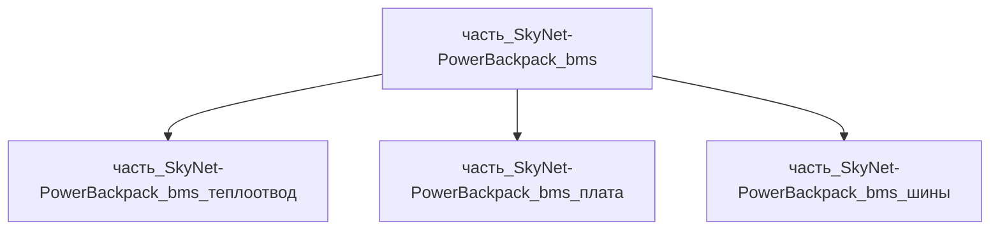

# Часть: часть_SkyNet-PowerBackpack_bms

## Описание

BMS-узел: плата 7s 120 А (балансировка ±20 мА, MOSFET-разрыв, CAN/UART-телеметрия) на алюминиевом теплоотводе 6061-T6 180×110×25 мм (масса 0.9 кг = 12% родителя — пластина + шины + разъёмы XT90/XT60).

Родитель: `izdelie_SkyNet-PowerBackpack` (подсистема: система_питания).

## Технические характеристики

| Параметр | Значение | Единица | Источник |
|---|---|---|---|
| подсистема | система_питания | — | canon |
| подтип | накопитель_энергии | — | canon |
| масса | 0.9 | kg | Samsung SDI INR21700-50E datasheet (69 g, 5000 mAh, Ø20.25×70.8 mm) |
| доля массы родителя | 0.12 | — | материалы_частей `izdelie_SkyNet-PowerBackpack` |
| габариты (Д×Ш×В) | 180×110×25 | mm | Samsung SDI INR21700-50E datasheet (69 g, 5000 mAh, Ø20.25×70.8 mm) |
| выработка энергии | 0 | W | canon |
| выработка тепла | 10 | W | Samsung SDI INR21700-50E datasheet (69 g, 5000 mAh, Ø20.25×70.8 mm) |
| материал | al_6061-t6 | — | al_6061-t6.md |

## Принцип работы

BMS следит за 7 последовательными группами (OVP 4.25 В, UVP 2.5 В, ток до 120 А), балансы через резистивные шунты; алюминиевая плита отводит 10 Вт потерь MOSFET к корпусу, CAN передаёт SoC/SoH в вычислительную подсистему.

## Состав

Промежуточная часть (уровень 2), сборка. Дочерние части (уровень 3, неделимые):

- `часть_SkyNet-PowerBackpack_bms_теплоотвод` — алюминиевая пластина-основание 6061-T6 (180×110×8 мм + рёбра, 0.63 кг);
- `часть_SkyNet-PowerBackpack_bms_плата` — плата управления JBD Smart 7S-24S (128×70×15 мм, CAN/UART, 120 А разрыв, 0.20 кг);
- `часть_SkyNet-PowerBackpack_bms_шины` — силовой тракт: медные перемычки + пара XT90-S (0.07 кг).

## Используемые материалы

- `al_6061-t6` (форма: теплоотводящие_узлы) → [`al_6061-t6.md`](../../../../материалы/al_6061-t6.md)
- `fr4` (форма: несущая_плата_PCB) → [`epoxy.md`](../../../../материалы/epoxy.md)
- `copper` (форма: шины_и_заземление) → [`copper.md`](../../../../материалы/copper.md)

## Источники

- Samsung SDI INR21700-50E datasheet (69 g, 5000 mAh, Ø20.25×70.8 mm): https://batteryservice.bg/wp-content/uploads/2018/12/INR21700-50E.pdf (проверено 2026-11-05)
- JBD Smart BMS 7S-24S 40A-150A Li-ion/LiFePO4 (UART/RS485/CAN): https://www.ebay.com/itm/267786963608 (проверено 2026-11-07)
- Jiabaida DB24SA03 Smart BMS 7S-24S (Li-ion, автодетект строк): https://jiabaida-bms.com/blogs/content/jiabaida-db24sa03-smart-bms-7s-24s-wiring-diagram (проверено 2026-11-07)
- TME Amass XT90E-F (DC connector 2 полюса, 500 В): https://www.tme.com/il/en/details/xt90e-f/dc-power-connectors/amass (проверено 2026-11-07)
- Материалы: реальные данные/материалы/

### Энергетический расчёт (web_search 2026-11-07)

Непрерывный ток нагрузки: 1500 Вт / 25.9 В = 58 А; разрыв MOSFET-банка 120 А (пик). Потери ключей: 58² × 2.5 мОм ≈ 8.4 Вт + AFE/MCU ~1 Вт → 9 Вт транзитом через алюминиевое основание 6061-T6 (k ≈ 167 Вт/(м·К)). Медные перемычки 16 мм²: R ≈ 170 мкОм → 0.6 Вт continuous / 2.4 Вт при пике 120 А. Суммарный тепловой баланс узла ≈ 10 Вт — сходится с canon-значением. Разъёмная пара XT90-S: 45 А номинал × 2 параллельно = 90 А continuous (запас 1.5×). Источники: JBD Smart BMS product line, AMASS XT90 datasheet V1.2.
