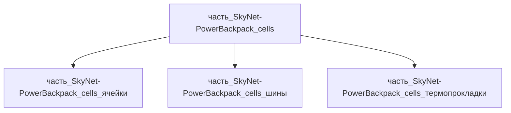

# Часть: часть_SkyNet-PowerBackpack_cells

## Описание

Аккумуляторный блок: 70× ячеек Samsung INR21700-50E (NMC/графит, 5000 mAh, 69 г, Ø20.25×70.8 мм) в конфигурации 7s10p — 25.9 В номинал, 50 Ач, ≈1.29 кВт·ч; ячеечная масса 70×0.069 = 4.83 кг ≈ 4.875 кг (65% родителя 7.5 кг), nickel-стяжки и межъячеечные термопрокладки.

Родитель: `izdelie_SkyNet-PowerBackpack` (подсистема: система_питания).

## Технические характеристики

| Параметр | Значение | Единица | Источник |
|---|---|---|---|
| подсистема | система_питания | — | canon |
| подтип | накопитель_энергии | — | canon |
| масса | 4.875 | kg | Samsung SDI INR21700-50E datasheet (69 g, 5000 mAh, Ø20.25×70.8 mm) |
| доля массы родителя | 0.65 | — | материалы_частей `izdelie_SkyNet-PowerBackpack` |
| габариты (Д×Ш×В) | 260×160×80 | mm | Samsung SDI INR21700-50E datasheet (69 g, 5000 mAh, Ø20.25×70.8 mm) |
| выработка энергии | 0 | W | canon |
| выработка тепла | 50 | W | Samsung SDI INR21700-50E datasheet (69 g, 5000 mAh, Ø20.25×70.8 mm) |
| материал | nmc_graphite | — | nmc_graphite.md |

## Принцип работы

Последовательно-параллельная сборка 7s10p выдаёт 25.9 В/50 Ач (1.29 кВт·ч, удельная ≈172 Вт·ч/кг pack-level — типично для NMC 21700); межъячеечные фазовые прокладки выравнивают температуру, никелевые шины спот-сварены по схеме 10p.

## Состав

Промежуточная часть (уровень 2), сборка. Дочерние части (уровень 3):

- `часть_SkyNet-PowerBackpack_cells_ячейки` — 70× Samsung INR21700-50E (неделимая закупочная ячейка);
- `часть_SkyNet-PowerBackpack_cells_шины` — никелевые соединительные шины (spot-weld 10p);
- `часть_SkyNet-PowerBackpack_cells_термопрокладки` — межъячеечные фазовые термопрокладки RT35.

## Используемые материалы

- `nmc_graphite` (форма: nmc811_graphite_baseline) → [`nmc_graphite.md`](../../../../материалы/nmc_graphite.md)
- `nickel` (форма: легирующий_элемент_и_покрытия) → [`nickel.md`](../../../../материалы/nickel.md)
- `pcm_rt35` (форма: аккумуляторные_термопрокладки) → [`paraffin.md`](../../../../материалы/paraffin.md)

## Источники

- Samsung SDI INR21700-50E datasheet (69 g, 5000 mAh, Ø20.25×70.8 mm): https://batteryservice.bg/wp-content/uploads/2018/12/INR21700-50E.pdf (проверено 2026-11-05)
- Материалы: реальные данные/материалы/

### Энергетический расчёт (web_search 2026-11-07)

Масса блока ячеек 4.875 кг / 69 г (Samsung INR21700-50E) ≈ **70 ячеек 21700**. Суммарная ёмкость: 70 × 5 Ач × 3.6 В = **1260 Втч**. Максимальный непрерывный разряд: 70 × 9.8 А × 3.6 В ≈ **2470 Вт** (datasheet Samsung 50E). Номинальная отдача 1500 Вт continuous — с 60 % запасом по току (термический режим, ресурс 500+ циклов при 0.6C). Потери на тепло при 1500 Вт (КПД ~95 %): ~75 Вт. Источник: Samsung INR21700-50E datasheet.
