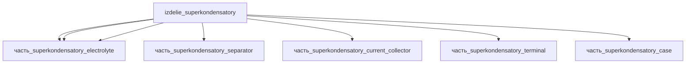

# Изделие: Суперконденсаторы

## Описание

Суперконденсаторы — одиночная цилиндрическая ячейка EDLC Maxwell BCAP3000 P270 (K2 Series): 3000 Ф, 2.7 В, Ø60.4 × 138 мм, масса 0.51 кг, ESR_DC = 0.29 мОм.

Полное наименование (как в CSV): `Суперконденсаторы`

## Технические характеристики

| Параметр | Значение | Единица | Источник |
|---|---|---|---|
| подсистема | энергетическая | — | classify_subsystem |
| категория | прочее | — | — |
| масса (реал) | 0.51 | kg | datasheet Maxwell BCAP3000 (1.124 lbs) |
| габариты (Д×Ш×В) | 138×60.4×60.4 | mm | bbox цилиндра Ø60.4×138 мм (datasheet Maxwell BCAP3000 P270 K04/K05) |
| ёмкость | 3000 | F | datasheet Maxwell BCAP3000 P270 |

(Энергетические параметры — номинал 0.5 кг канон; реал 0.51 кг по datasheet)

## Состав

Изделие верхнего уровня (одиночная ячейка BCAP3000). Шесть дочерних частей:

- `часть_superkondensatory_electrode_pos` — позитивный электрод: активированный уголь на углеволоконной подложке, 2 шт (симметричный EDLC)
- `часть_superkondensatory_separator` — целлюлозный сепаратор, 2 ленты
- `часть_superkondensatory_electrolyte` — электролит 1M TEABF4 в ацетонитриле
- `часть_superkondensatory_current_collector` — травленая алюминиевая фольга токосъёмника
- `часть_superkondensatory_terminal` — резьбовые силовые выводы M12×1.75 (пара)
- `часть_superkondensatory_case` — тянутый алюминиевый корпус ячейки (Al can)

## Используемые технологии

(Ссылки на реальные_данные/технологии/ добавляются после связывания)

## Используемые материалы

(Ссылки на реальные_данные/материалы/ добавляются после связывания)

## Принцип работы

EDLC: спиральная намотка «электрод | сепаратор | электрод | сепаратор» (технология spiralnaya_navivka) — активированный уголь на углеволоконной подложке; заряд накапливается электростатически на границе уголь/электролит (двойной электрический слой, ионы TEA+/BF4⁻ в ацетонитриле) без фарадеевских реакций — отсюда >1 000 000 duty cycles и низкое ESR_DC 0.29 мОм. Токосъёмники — травленая алюминиевая фольга, соединённая с резьбовыми терминалами M12×1.75, выведенными через крышку тянутого алюминиевого корпуса (Al can).

## Источники

- CSV: `начальные данные_final.csv` (пользовательский ввод)
- Maxwell Technologies datasheet «2.7V 3000F Ultracapacitor Cell BCAP3000 P270» — ESR_DC=0.29 мОм, формула IMAX (максимальный непрерывный ток): https://maxwell.com/wp-content/uploads/2024/07/3003279-EN.3_DS_2.7V-3000F-Cell-BCAP3000-P270_20240704.pdf (проверено 2026-11-08)
- Maxwell K2 Series 650–3000F datasheet — Maximum Continuous Current: 130 A_RMS (ΔT=15°C), 210 A_RMS (ΔT=40°C): https://media.pneda.com/datasheetfiles/130135.pdf (проверено 2026-11-08)
- Maxwell BCAP3000 P270 K04/K05 — габариты ячейки Ø60.4 мм × 138 мм (2.390″ Dia × 5.433″ L), масса 0.51 кг (1.124 lbs): datasheet 3003279-EN.3 + дистрибьюторские листинги Mouser/DigiKey (проверено 2026-11-09)

---

## Декомпозиция

