---

id: izdelie_svintsovo-kislotnye_akb
тип: изделие
категория: энергетика
уровень_иерархии: верхний
уровень_номер: 1
подсистема: система_питания
подтип: свинцово-кислотная_батарея
стандарты: 
  - IEC 60095
  - JIS D5301
исследовательская_группа: exide
родитель: null
дочерние_части:
  - часть_svintsovo-kislotnye_akb_anode
  - часть_svintsovo-kislotnye_akb_cathode
  - часть_svintsovo-kislotnye_akb_electrolyte
  - часть_svintsovo-kislotnye_akb_separator
  - часть_svintsovo-kislotnye_akb_grid_pos
  - часть_svintsovo-kislotnye_akb_case
  - часть_svintsovo-kislotnye_akb_terminal
материалы_частей:
  - часть: часть_svintsovo-kislotnye_akb_anode
    материал: pbo2
    форма: положительная_пластина_свинцовой_акб
    доля_массы: 0.19
  - часть: часть_svintsovo-kislotnye_akb_cathode
    материал: spongy_lead
    форма: sli_стартерные_акб
    доля_массы: 0.19
  - часть: часть_svintsovo-kislotnye_akb_electrolyte
    материал: h2so4_aqueous
    форма: vrla_agm_иммобилизованный
    доля_массы: 0.285
  - часть: часть_svintsovo-kislotnye_akb_separator
    материал: sio2_amorphous
    форма: hybrid_agm
    доля_массы: 0.019
  - часть: часть_svintsovo-kislotnye_akb_grid_pos
    материал: pb_sb_alloy
    форма: стартерные_SLI_решётки
    доля_массы: 0.095
  - часть: часть_svintsovo-kislotnye_akb_case
    материал: polypropylene
    форма: литьевой_моноблок_ppcp
    доля_массы: 0.095
  - часть: часть_svintsovo-kislotnye_akb_terminal
    материал: latun_c36000
    форма: пруток_автоматный_ASTM_B16
    доля_массы: 0.0013
технологии_частей:
  - часть: часть_svintsovo-kislotnye_akb_anode
    технология: pogruzhenie_v_mo-shliker
    доля_использования: 1.0
    материалы_для_процесса:
      - материал: pbo2
        роль: обрабатываемый
  - часть: часть_svintsovo-kislotnye_akb_cathode
    технология: pogruzhenie_v_mo-shliker
    доля_использования: 1.0
    материалы_для_процесса:
      - материал: spongy_lead
        роль: обрабатываемый
  - часть: часть_svintsovo-kislotnye_akb_electrolyte
    технология: vio
    доля_использования: 1.0
    материалы_для_процесса:
      - материал: h2so4_aqueous
        роль: обрабатываемый
  - часть: часть_svintsovo-kislotnye_akb_separator
    технология: pogruzhenie_v_mo-shliker
    доля_использования: 1.0
    материалы_для_процесса:
      - материал: sio2_amorphous
        роль: обрабатываемый
  - часть: часть_svintsovo-kislotnye_akb_grid_pos
    технология: otzhig
    доля_использования: 1.0
    материалы_для_процесса:
      - материал: pb_sb_alloy
        роль: обрабатываемый
  - часть: часть_svintsovo-kislotnye_akb_case
    технология: sborka_v_termoizolyatsionnoi_opravke
    доля_использования: 1.0
    материалы_для_процесса:
      - материал: polypropylene
        роль: обрабатываемый

наследуемые_материалы:
  - материал: pbo2
    форма: положительная_пластина_свинцовой_акб
    суммарная_доля_массы: 0.19
    источники_частей:
      - часть_svintsovo-kislotnye_akb_anode
  - материал: spongy_lead
    форма: sli_стартерные_акб
    суммарная_доля_массы: 0.19
    источники_частей:
      - часть_svintsovo-kislotnye_akb_cathode
  - материал: h2so4_aqueous
    форма: vrla_agm_иммобилизованный
    суммарная_доля_массы: 0.285
    источники_частей:
      - часть_svintsovo-kislotnye_akb_electrolyte
  - материал: sio2_amorphous
    форма: hybrid_agm
    суммарная_доля_массы: 0.019
    источники_частей:
      - часть_svintsovo-kislotnye_akb_separator
  - материал: pb_sb_alloy
    форма: стартерные_SLI_решётки
    суммарная_доля_массы: 0.095
    источники_частей:
      - часть_svintsovo-kislotnye_akb_grid_pos
  - материал: polypropylene
    форма: литьевой_моноблок_ppcp
    суммарная_доля_массы: 0.095
    источники_частей:
      - часть_svintsovo-kislotnye_akb_case
  - материал: latun_c36000
    форма: пруток_автоматный_ASTM_B16
    суммарная_доля_массы: 0.0013
    источники_частей:
      - часть_svintsovo-kislotnye_akb_terminal

масштабируемость:
  режим: квантуемая
  параметры: [масса_kg, ёмкость_Ач, выработка_энергии_W]
  пределы:
    min: {масса_kg: 5, ёмкость_Ач: 40, выработка_энергии_W: 50}
    max: {масса_kg: 50, ёмкость_Ач: 250, выработка_энергии_W: 1000}
  закон_масштабирования:
    масса: 'пропорционален ёмкости (Ач) и числу банок; удельная энергия SLI ≈ 35 Вт·ч/кг (12 В/100 Ач ≈ 15 кг)'
    энергия: 'P = U·I; номинал 500 Вт при 12 В/100 Ач (0.42C); масштабируется с ёмкостью и числом параллельных банок'
    тепло: 'I²R (BU-802a); растёт квадратично с током разряда: 8.8 Вт при 41.7 А, ~35 Вт при 83.3 А'
  ограничивающие_части:
    - часть: часть_svintsovo-kislotnye_akb_electrolyte
      предел: '28.5% массы — объём иммобилизованного H₂SO₄ задаёт ёмкость в Ач и габариты банки'
    - часть: часть_svintsovo-kislotnye_akb_case
      предел: 'габариты 350×175×190 мм и масса 5–50 кг; моноблок PP ограничивает число ячеек'
    - часть: часть_svintsovo-kislotnye_akb_anode
      предел: 'активная масса PbO₂ 0.19–0.25 определяет ёмкость в Ач (порог перколяции пасты)'

scaling_type: количественный
соединители: []
версия: реальная
статус_реальности: real
доступность: промышленный
статус: извлечено
ии_перепроектирован:
  статус: false
  верификация: []
основные: 
  масса_kg:
          min: 5
          max: 50
          nominal: 15
  габариты_mm:
          l: 350
          w: 175
          h: 190
  выработка_энергии_W:
          min: 50
          max: 1000
          nominal: 500
  выработка_тепла_W:
          min: 1
          max: 50
          nominal: 10
наследуемые: {}
дополнительные: 
  ёмкость_Ач: 100
  V: 12
  T_жизни_циклы: 500
  источник: Exide lead-acid battery
дата_создания: 2026-11-03
дата_обновления: 2026-11-09
источник: user_input
источник_разбора: пользовательский ввод
---
## Описание

свинцово-кислотные АКБ

Полное наименование (как в CSV): `свинцово-кислотные АКБ`

## Технические характеристики

| Параметр | Значение | Единица | Источник |
|---|---|---|---|
| подсистема | система_питания | — | canon |
| подтип | свинцово-кислотная_батарея | — | canon |
| масса | 5–50 (номинал 15) | kg | canon |
| габариты (Д×Ш×В) | 350×175×190 | mm | canon |
| выработка энергии | 50–1000 | W | canon |
| выработка тепла | 1–50 | W | canon |
| тип узла | изделие | — | canon |
| уровень_номер | 1 | — | canon |

## Принцип работы

Требует описания на основе инженерного анализа.

## Состав

Изделие верхнего уровня, 7 дочерних частей: анод (PbO₂-пластина), катод (губчатый Pb), электролит (H₂SO₄, VRLA AGM), сепаратор (AGM, hybrid), решётка положительная (Pb-Sb), корпус (PP-моноблок), клемма (латунь C36000).

## Используемые технологии

- `pogruzhenie_v_mo-shliker` (доля: 1.0)
- `pogruzhenie_v_mo-shliker` (доля: 1.0)
- `vio` (доля: 1.0)
- `pogruzhenie_v_mo-shliker` (доля: 1.0)
- `otzhig` (доля: 1.0)
- `sborka_v_termoizolyatsionnoi_opravke` (доля: 1.0)

## Используемые материалы

- `pbo2` (форма: положительная_пластина_свинцовой_акб) → [`pbo2`](../../../материалы/pbo2.md)
- `spongy_lead` (форма: sli_стартерные_акб) → [`spongy_lead`](../../../материалы/spongy_lead.md)
- `h2so4_aqueous` (форма: vrla_agm_иммобилизованный) → [`h2so4_aqueous`](../../../материалы/h2so4_aqueous.md)
- `sio2_amorphous` (форма: hybrid_agm) → [`sio2_amorphous`](../../../материалы/sio2_amorphous.md)
- `pb_sb_alloy` (форма: стартерные_SLI_решётки) → [`pb_sb_alloy`](../../../материалы/pb_sb_alloy.md)
- `polypropylene` (форма: литьевой_моноблок_ppcp) → [`polypropylene`](../../../материалы/polypropylene.md)
- `latun_c36000` (форма: пруток_автоматный_ASTM_B16) → [`latun_c36000`](../../../материалы/latun_c36000.md)

## Источники

- CSV: `начальные данные_final.csv` (пользовательский ввод)

---

- Wikipedia — Lead–acid battery (E°cell = 2.05 В; КПД заряда/разряда 50–95 %; реакции пластин Pb/PbO2): https://en.wikipedia.org/wiki/Lead%E2%80%93acid_battery (обращение 2026-11-07)
- Battery University BU-802a — How does Rising Internal Resistance Affect Performance (I²R — принятая производителями оценка тепловыделения при разряде): https://batteryuniversity.com/article/bu-802a-how-does-rising-internal-resistance-affect-performance (обращение 2026-11-07)

## Декомпозиция

```mermaid
graph TD
    izdelie_svintsovo_kislotnye_akb["izdelie_svintsovo-kislotnye_akb"]
    ______svintsovo_kislotnye_akb_anode["часть_svintsovo-kislotnye_akb_anode"]
    izdelie_svintsovo_kislotnye_akb --> ______svintsovo_kislotnye_akb_anode
    ______svintsovo_kislotnye_akb_cathode["часть_svintsovo-kislotnye_akb_cathode"]
    izdelie_svintsovo_kislotnye_akb --> ______svintsovo_kislotnye_akb_cathode
    ______svintsovo_kislotnye_akb_electrolyte["часть_svintsovo-kislotnye_akb_electrolyte"]
    izdelie_svintsovo_kislotnye_akb --> ______svintsovo_kislotnye_akb_electrolyte
    ______svintsovo_kislotnye_akb_separator["часть_svintsovo-kislotnye_akb_separator"]
    izdelie_svintsovo_kislotnye_akb --> ______svintsovo_kislotnye_akb_separator
    ______svintsovo_kislotnye_akb_grid_pos["часть_svintsovo-kislotnye_akb_grid_pos"]
    izdelie_svintsovo_kislotnye_akb --> ______svintsovo_kislotnye_akb_grid_pos
    ______svintsovo_kislotnye_akb_case["часть_svintsovo-kislotnye_akb_case"]
    izdelie_svintsovo_kislotnye_akb --> ______svintsovo_kislotnye_akb_case
    ______svintsovo_kislotnye_akb_terminal["часть_svintsovo-kislotnye_akb_terminal"]
    izdelie_svintsovo_kislotnye_akb --> ______svintsovo_kislotnye_akb_terminal
```

## Энергетический баланс (F15d)

Источник отдачи батареи — электрохимическая пара «губчатый Pb (отрицательная пластина) ↔ PbO2 (положительная пластина)»: суммарная ЭДС ячейки E° = 2.05 В (Wikipedia, Lead–acid battery). Учётная мощность пары: 250 Вт (PbO2-пластина) + 250 Вт (Pb-пластина) = 500 Вт — номинал родителя. Ток разряда при номинале: I = P/U = 500/12 ≈ 41.7 А (≈0.42C для 100 Ач); через обе пластины течёт один и тот же ток, мощность пары делится между активными массами поровну (канон-модель, аналогично izdelie_tverdotelnye_akkumulyatory). Пассивные части (электролит, сепаратор, решётки, корпус, клемма) энергию не генерируют — выработка_энергии_W = 0.

## Тепловой баланс (F15b)

Тепловыделение при разряде аппроксимируется I²R (Battery University BU-802a — принятая производителями оценка). При I = 41.7 А и распределённом внутреннем сопротивлении R_eff ≈ 5.1 мОм потери детей:

| Часть | Тепло, Вт | Механизм |
|---|---|---|
| электролит (H2SO4) | 3.0 | ионная омическая составляющая |
| анод (PbO2-пластина) | 2.5 | омические потери пасты + перенапряжение восстановления |
| катод (Pb-пластина) | 2.0 | омические потери пасты + перенапряжение окисления |
| решётка (Pb-Sb) | 0.6 | омические потери сплава токоотвода (на экземпляр) |
| клемма | 0.5 | контактные + омические потери вывода |
| сепаратор (AGM) | 0.2 | джоулево тепло порового электролита |
| корпус (PP) | 0 | пассивный контейнер, ток не проводит |

Σ детей = 8.8 Вт ≤ номинала родителя 10 Вт — F15b выполнено (запас 1.2 Вт — собственный нагрев межэлементных соединений). При максимальной отдаче 1000 Вт (I = 83.3 А) I²R ≈ 35 Вт ≤ max 50 Вт родителя — согласовано.
