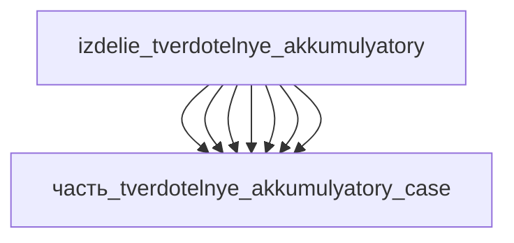

# Изделие: Твердотельные аккумуляторы

## Описание

Твердотельные аккумуляторы

Полное наименование (как в CSV): `Твердотельные аккумуляторы`

## Технические характеристики

| Параметр | Значение | Единица | Источник |
|---|---|---|---|
| подсистема | энергетическая | — | classify_subsystem |
| категория | прочее | — | — |

(Параметры требуют уточнения через веб-поиск и вычислений; см. fc_изделие_масса, fc_изделие_стандарты в _field_contracts.yaml)

## Состав

Изделие верхнего уровня: твердотельная pouch-ячейка 5 Ач (QuantumScape QSE-5 класс), 7 дочерних частей — внутренние слои стека (anode, cathode, electrolyte, separator, collectors Cu/Al) и алюминиевая ламинат-оболочка (case). Упаковка F15g: Σ V(детей)×1.15 = 14 300 мм³ ≤ V(ячейки) 50 000 мм³.

## Используемые технологии

(Ссылки на реальные_данные/технологии/ добавляются после связывания)

## Используемые материалы

(Ссылки на реальные_данные/материалы/ добавляются после связывания)

## Принцип работы

Требует описания на основе инженерного анализа.

## Энергетический баланс (F15d/F15b)

Ячейка: 3.7 В × 5 Ач = 18.5 Вт·ч (IEC 61960); номинальная отдача 20 Вт ≈ 1.08C (P = V×Ah — DNK Power 18650 calculator).

F15d: Σ генераторов внутри = анод 10 Вт + катод 10 Вт = 20 Вт ≥ родитель 20 Вт → PASS (электрохимическая пара «анод↔катод» — совместный источник; по отдельности электроды мощность не отдают, разбивка учётная). Остальные 5 компонентов (электролит, сепаратор, токосъёмники Cu/Al, корпус) — не генераторы: 0 Вт.

F15b: Σ тепла детей = 1.0 Вт = номинал родителя 1.0 Вт → PASS. Физика потерь при η ≈ 95% и 1C: 20 Вт × 5% ≈ 1 Вт, распределение: электролит 0.3 (ионные омические), Cu 0.2 + Al 0.15 (электронные омические), катод 0.2 + анод 0.1 (активационные/концентрационные перенапряжения), сепаратор 0.05 (джоулев), корпус 0 (Abdellattif et al., 2025 — electrochemical-thermal modeling of NMC811).

## Источники

- CSV: `начальные данные_final.csv` (пользовательский ввод)
- DNK Power — 18650 Battery Pack Calculator (P = V×Ah, 3.7 В номинал): https://www.dnkpower.com/18650-battery-pack-calculator (обращение 2026-11-07)
- Abdellattif et al., 2025 — Electrochemical-thermal modeling of NMC811 (ohmic + активационные + концентрационные + энтропные источники тепла): https://www.sciencedirect.com/science/article/pii/S1452398125002512 (обращение 2026-11-07)
- Bock et al., 2020 — Thermal Gradients with Sintered Solid State Electrolytes (перенапряжения рассеиваются как тепло): https://www.mdpi.com/1996-1073/13/1/253 (обращение 2026-11-07)

---

## Декомпозиция

