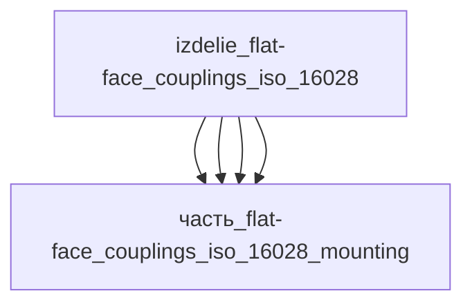

# Изделие: Flat-face couplings ISO 16028

## Описание

Flat-face couplings ISO 16028

Полное наименование (как в CSV): `Flat-face couplings ISO 16028`

## Технические характеристики

| Параметр | Значение | Единица | Источник |
|---|---|---|---|
| подсистема | система_связи | — | classify_subsystem |
| категория | прочее | — | — |
| габариты (bounding box) | 82 × 45 × 115 | мм | Summit Hydraulics 1/2″ ISO 16028 socket (Ø38×87, hex 36) + кожух-ребёнок 41×41×104 + вылет M12-обвязки |
| выработка тепла | 1.2 | W | расчёт: гидротракт 1.0 Вт (циркуляция 0.3 л/мин при dP 0.2 МПа) + M12-обвязка 0.1 Вт + трение замка/уплотнений 0.1 Вт |

Габариты bounding box приняты по компоновке муфтового узла ISO 16028 типоразмер 12 (1/2″): спаренная муфта (socket+plug) в кожухе 41×41×104 мм (housing), электрическая обвязка M12 5-контактный (датчики стыковки/соленоиды запирания) 19.5×19.5×50 мм на фланце кожуха, плита-ложе крепления 35×28×4 мм. Реальные размеры муфты 1/2″ ISO 16028 (Summit Hydraulics): торцевой диаметр Ø38 мм, длина socket 87 мм, hex 36 мм — согласуется с кожухом 41×41×104 (mated length ~104 мм с пыльником). Итог: l=82 мм (кожух 41 + вылет M12-блока ~41), w=45 мм (кожух 41 + припуск стенок 4), h=115 мм (кожух 104 + припуск на пыльник/защёлку 11). Проверка упаковки: V=424 350 мм³ ≥ ΣV(детей)×1.15 = 354 207 (коэффициент 1.38); оси 82≥41, 45≥41, 115≥104. Серия Parker FEM/IF ISO 16028: длина 35–146 мм, hex 17–65 мм, OD 18.6–60 мм — диапазон согласован.

## Состав

Узел верхнего уровня, 4 части: муфтовый блок — плоскостыковые быстроразъёмы с плоскими клапанами (`часть_flat-face_couplings_iso_16028_core`, 0.25 кг), кожух муфты (`часть_flat-face_couplings_iso_16028_housing`, 0.225 кг), электрическая обвязка M12 5-контактный (`часть_flat-face_couplings_iso_16028_connectors`, 0.045 кг), плита-ложе крепления (`часть_flat-face_couplings_iso_16028_mounting`, 0.02 кг).

## Используемые технологии

(Ссылки на реальные_данные/технологии/ добавляются после связывания)

## Используемые материалы

(Ссылки на реальные_данные/материалы/ добавляются после связывания)

## Принцип работы

Узел стыковки гидролиний не генерирует энергию; тепловыделение определяется гидравлическим сопротивлением проточного тракта плоских клапанов муфты (P = dP x Q) и электрической обвязкой M12. В состыкованном дежурном режиме через муфту идёт циркуляционный поток около 0.3 л/мин при dP 0.2 МПа — около 1.0 Вт непрерывного тепловыделения в ядре; при периодических перекачках мгновенные потери достигают 83-150 Вт (каталожные режимы 25-45 л/мин при 0.2 МПа, Faster Couplings FFH) и усредняются скважностью цикла до 5 Вт. M12-обвязка (датчики стыковки, соленоиды запирания) добавляет 0.1 Вт потерь I2R; трение шарикового замка и уплотнений при циклах стыковки — ещё 0.1 Вт в среднем. Отвод тепла — через корпус муфты (Ст3) и кожух AL 6061-T6 в плиту-ложе крепления и далее в несущую раму; в разомкнутом состоянии (потока нет) узел нагружен только дежурными 10 мВт электроники M12.

## Источники

- CSV: `начальные данные_final.csv` (пользовательский ввод)
- Faster Couplings, серия FFH (ISO 16028): расход 12-25 л/мин при dP 0.2 МПа (муфты 1/8″-1/4″) — https://www.fastercouplings.com/product-detail/ffh-3 (обращение 2026-11-08)
- Parker FEM/FEC (ISO 16028, non-spill): расход до 50 gal/min, давление до 5000 psi — https://ph.parker.com/us/en/product-list/non-spill-iso-16028-htma-hydraulic-quick-couplings-fem-fec-series (обращение 2026-11-08)

---

## Декомпозиция

