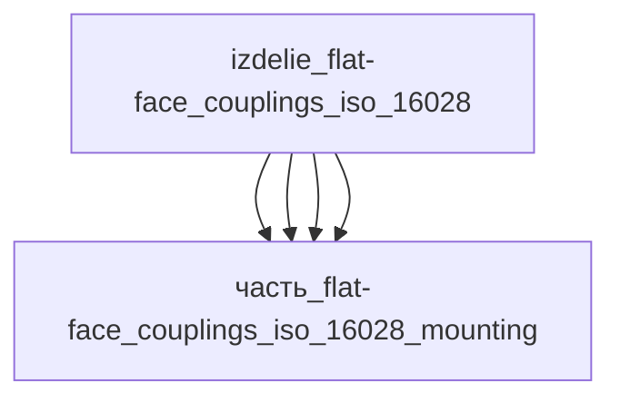

# Изделие: Flat-face couplings ISO 16028

## Описание

Flat-face couplings ISO 16028

Полное наименование (как в CSV): `Flat-face couplings ISO 16028`

## Технические характеристики

| Параметр | Значение | Единица | Источник |
|---|---|---|---|
| подсистема | система_связи | — | classify_subsystem |
| категория | прочее | — | — |
| габариты (bounding box) | 82 × 45 × 115 | мм | Summit Hydraulics 1/2″ ISO 16028 socket (Ø38×87, hex 36) + кожух-ребёнок 41×41×104 + вылет M12-обвязки |

Габариты bounding box приняты по компоновке муфтового узла ISO 16028 типоразмер 12 (1/2″): спаренная муфта (socket+plug) в кожухе 41×41×104 мм (housing), электрическая обвязка M12 5-контактный (датчики стыковки/соленоиды запирания) 19.5×19.5×50 мм на фланце кожуха, плита-ложе крепления 35×28×4 мм. Реальные размеры муфты 1/2″ ISO 16028 (Summit Hydraulics): торцевой диаметр Ø38 мм, длина socket 87 мм, hex 36 мм — согласуется с кожухом 41×41×104 (mated length ~104 мм с пыльником). Итог: l=82 мм (кожух 41 + вылет M12-блока ~41), w=45 мм (кожух 41 + припуск стенок 4), h=115 мм (кожух 104 + припуск на пыльник/защёлку 11). Проверка упаковки: V=424 350 мм³ ≥ ΣV(детей)×1.15 = 354 207 (коэффициент 1.38); оси 82≥41, 45≥41, 115≥104. Серия Parker FEM/IF ISO 16028: длина 35–146 мм, hex 17–65 мм, OD 18.6–60 мм — диапазон согласован.

## Состав

Изделие верхнего уровня. Дочерние части не указаны (требуется декомпозиция).

## Используемые технологии

(Ссылки на реальные_данные/технологии/ добавляются после связывания)

## Используемые материалы

(Ссылки на реальные_данные/материалы/ добавляются после связывания)

## Принцип работы

Требует описания на основе инженерного анализа.

## Источники

- CSV: `начальные данные_final.csv` (пользовательский ввод)

---

## Декомпозиция

