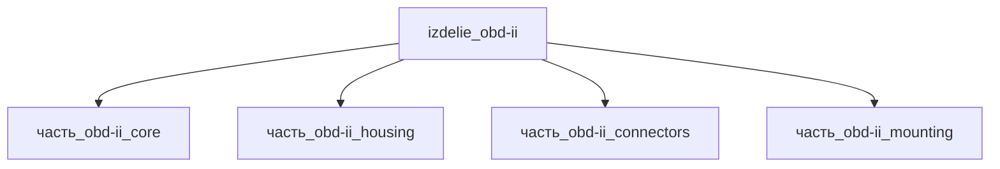

# Изделие: OBD-II

## Описание

OBD-II

Полное наименование (как в CSV): `OBD-II`

## Технические характеристики

| Параметр | Значение | Единица | Источник |
|---|---|---|---|
| подсистема | система_связи | — | classify_subsystem |
| категория | прочее | — | — |
| габариты (bounding box) | 76 × 51 × 45 | мм | под-панельный DLC-кронштейн 75.9×51.1 мм (eBay/Mobilistics) + кожух 38 мм |

Габариты bounding box приняты по компоновке под-панельного диагностического узла OBD-II (SAE J1962): монтажная пластина-кронштейн 70×45×3 мм (mounting, SAE J1962_201607 — канон), кожух ядра 56×30×38 мм (housing), ядро 48×26×33 мм (core), разъём J1962 30.81×12.55×8.6 мм (connectors). Итог: l=76 и w=51 мм — габарит реального под-панельного монтажного кронштейна DLC (2.99×2.01 in = 75.9×51.1 мм); h=45 мм = пластина 3 + кожух 38 + припуск ~4 мм на винты/уплотнитель. Проверка упаковки: V=174 420 мм³ ≥ ΣV(детей)=117 799 × 1.15 (коэффициент 1.48); оси 76≥70, 51≥45, 45≥38. Ручные сканеры-аналоги (Autel AutoLink AL319, 117×72×18 мм, 0.18 кг) — другая форма-фактор: плоский корпус с экраном, не вмещает вертикальный кожух 38 мм.

## Состав

Изделие верхнего уровня. Дочерние части не указаны (требуется декомпозиция).

## Используемые технологии

(Ссылки на реальные_данные/технологии/ добавляются после связывания)

## Используемые материалы

(Ссылки на реальные_данные/материалы/ добавляются после связывания)

## Принцип работы

Требует описания на основе инженерного анализа.

## Источники

- CSV: `начальные данные_final.csv` (пользовательский ввод)

---

## Декомпозиция

